# CIM OffBoarding — Admin User Manual

**Version:** 1.0 &nbsp;|&nbsp; **Revision date:** October 16, 2026 &nbsp;|&nbsp; **Audience:** HR personnel and system administrators (Admin role)

## Introduction and scope

This manual explains, in plain English and with verified step-by-step instructions, how an Admin user operates every module of the CIM OffBoarding application — from signing in, through configuring the system, to running an offboarding case from creation through Final Approval. It was written by directly inspecting the application's actual routes, controllers, forms, and screens, not by assuming how a feature "should" work. Every button label, field name, and validation message quoted here was verified against the live application. Where something could not be confirmed, it is explicitly marked **UNVERIFIED** rather than guessed at.

This is a documentation-only resource — no part of writing it involved changing the application's code, database, or configuration.

## Table of contents

1. Sign-in and first-time password change
2. Admin modules
   - A. [Dashboard](#a-dashboard)
   - B. [User Profile](#b-user-profile)
   - C. [Offboarding Checklist](#c-offboarding-checklist)
   - D. [Offboardee](#d-offboardee)
   - E. [Employee Master](#e-employee-master)
   - F. [Approval](#f-approval)
   - G. [Calendar](#g-calendar)
   - H. [Email and Notification](#h-email-and-notification)
   - I. [Separation Type](#i-separation-type)
   - J. [Reports](#j-reports)
   - K. [Roles and Permissions](#k-roles-and-permissions)
   - L. [Users](#l-users)
   - M. [Logs](#m-logs)
   - N. [Mail Settings](#n-mail-settings)
3. [The complete offboarding process, step by step](#3-the-complete-offboarding-process-step-by-step)
4. [Status definitions and terminology](#4-status-definitions-and-terminology)
5. [Common errors and troubleshooting](#5-common-errors-and-troubleshooting)
6. [Frequently asked questions](#6-frequently-asked-questions)

A separate, more detailed walkthrough of the end-to-end workflow (with a diagram) is also available as [`offboarding-workflow.md`](offboarding-workflow.md) / `offboarding-workflow.pdf`.

---

## 1. Sign-in and first-time password change

**Access:** No permission required — anyone with an account can sign in.

### Signing in

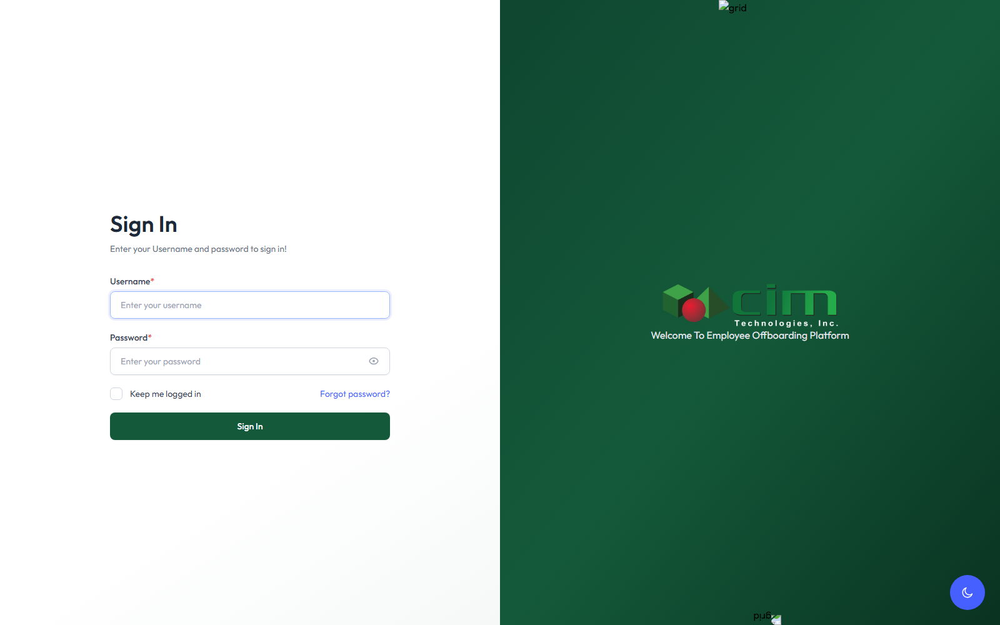

1. Open the CIM OffBoarding application's Sign In page.
2. In the **Username** field, enter your employee number **without** the "EMP" prefix (for example, employee number `EMP03050` signs in as `03050`).
3. In the **Password** field, enter your password. **For an account that still has its initial default credentials, the password is the same value as the username** — this is only true for an account that hasn't had its password changed yet; it is not the permanent password for every account, and does not apply once someone has already set their own password.
4. Optionally tick **"Keep me logged in."**
5. Click **Sign In**.

If your password still matches your username, the system detects this automatically and redirects you to the **Change Password** page — you cannot access any other page until you do this.

### Changing your initial password

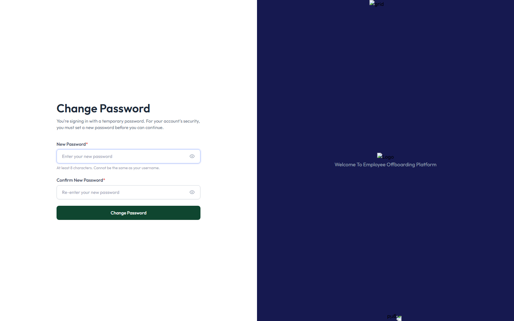

On the **Change Password** page:
1. Enter a **New Password\*** — it must be at least **8 characters**, and it **cannot be the same as your username**.
2. Re-enter the same value in **Confirm New Password\*** (it must match exactly).
3. Click **Change Password**.

On success, you're taken straight to the Dashboard with the confirmation message *"Your password has been changed successfully."* There is no separate "current password" field on this particular form — it is reached only immediately after signing in with the still-valid temporary password, so the application already knows who you are.

### Forgotten password
If you don't remember your password at all (rather than just having an unchanged temporary one), click **"Forgot password?"** on the Sign In page, enter your email address, and follow the link sent to you — that link expires after **5 minutes** and can only be used once.

### Account lockout
Three incorrect password attempts in a row **permanently blocks** the account (it does not unlock itself over time). An Admin must reactivate it from the **Users** page (see [§L](#l-users)).

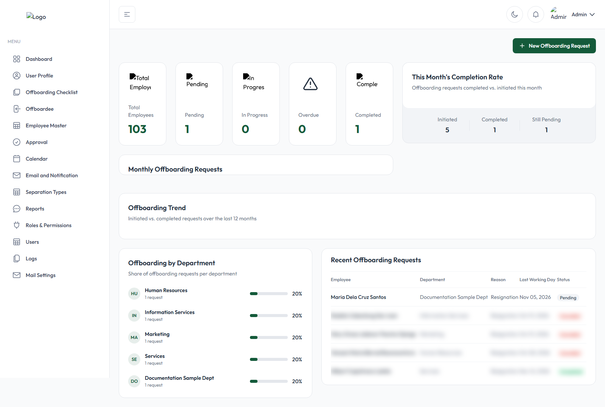

---

## 2. Admin modules

### A. Dashboard

**Purpose:** A single-page overview of the organization's current offboarding activity.
**Access:** Menu item **Dashboard** (needs the `dashboard.view` permission).

The Dashboard shows:

| Element | What it actually shows |
|---|---|
| **Total Employees** | Every employee whose status is not "Offboarded" — i.e. everyone currently active or mid-offboarding. |
| **Active Employees** | Employees whose status is specifically "Active" (not mid-offboarding, not yet offboarded). |
| **Pending** | Count of offboarding requests whose displayed status is Pending. |
| **In Progress** | Count of offboarding requests currently In Progress. |
| **Overdue** | Count of requests with at least one checklist past its due date. |
| **Completed** | Count of requests whose stored status is Completed. |
| **This Month's Completion Rate** | For the current calendar month: how many requests were *initiated* vs. how many were *completed*, with a completion percentage, plus how many are still pending from that same group. |
| **Monthly Offboarding Requests / Offboarding Trend chart** | A 12-month chart comparing the number of requests *initiated* each month against the number *completed* each month. |
| **Offboarding by Department** | A breakdown of how many offboarding requests have come from each department, as a percentage of the total. |
| **Recent Offboarding Requests** | A table of the 6 most recently created requests — employee, department, reason, Last Working Day, and status. |

Click **"New Offboarding Request"** in the top-right corner to start a new request directly from the Dashboard — this opens the exact same form described in [§D](#d-offboardee) and [§3, Step 2](#3-the-complete-offboarding-process-step-by-step).

---

### B. User Profile

**Purpose:** View and maintain your own account details, including the electronic signature used on approvals and the Clearance Form.
**Access:** Menu item **User Profile** — available to every signed-in account regardless of role; which specific fields can be *edited* depends on the `user-profile.edit-personal-info`, `.edit-contact-info`, `.edit-employment-info`, `.edit-photo`, and `.edit-signature` permissions (Admin has all of these by default).

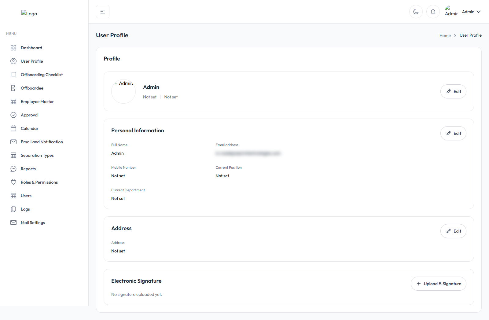

The page is organized as a header card plus four stacked cards: **Employment Information → Personal Information → Address → Electronic Signature.**

**Employment Information** — fully read-only (Employee Number, Full Name, Position, Department, Email, Date Hired): *"Employment information is managed by HR and cannot be edited here."*

**Personal Information** — click **"Edit"** to open the **"Edit Personal Information"** modal: **Full Name, Email Address, Mobile Number, Current Position, Current Department.** Any field you lack edit permission for appears greyed out. Click **Save Changes**. Full Name and Email Address are required; Email must be a valid, unique address.

**Address** — click **"Edit"** on the Address card to update the free-text **Address** field (up to 500 characters), then **Save Changes**.

**Profile Photo** — click the avatar (if you have photo-edit permission) to open **"Upload Profile Photo."** Accepts PNG or JPG, **up to 2MB**. After choosing a file you'll see a preview before saving; **"Remove Photo"** reverts to the default image.

### Electronic signature

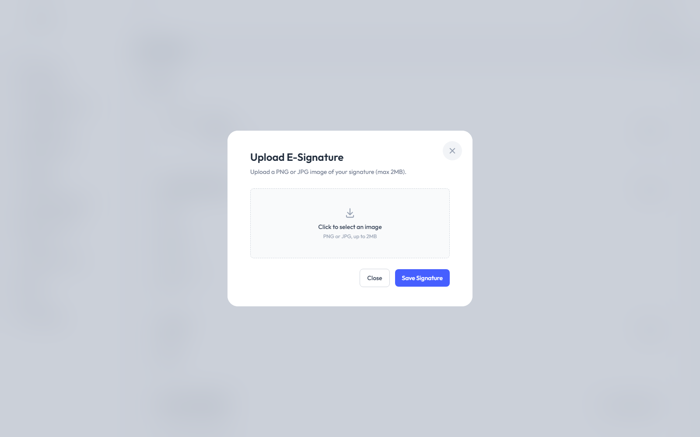

Your e-signature is what actually appears on approvals and the Clearance Form, and it's **required before you can approve anything** — a checklist, a General Signatory assignment, or a Final Approval will all redirect you back here with an error message if you try to approve without one on file.

**To upload or replace your signature:**
1. Scroll to the **"Electronic Signature"** card.
2. Click **"Upload E-Signature"** (or **"Update Signature"** if you already have one).
3. Click **"Click to select an image"** and choose a **PNG or JPG file**.
   > The on-screen text says "up to 2MB," but the server actually enforces a slightly smaller limit of **1,900 KB (about 1.86 MB)** — a file between 1.86 MB and 2 MB will be rejected with *"The signature field must not be greater than 1900 kilobytes."* Keep your signature image comfortably under 1.86 MB to avoid this.
4. Review the preview shown (or click **"Choose a different file"** to pick a different image).
5. Click **"Save Signature."**

**How to confirm it worked:** after saving, you're returned to this page with the green banner *"E-signature uploaded."* — and the card itself now displays your signature image directly (this image preview, not just the success message, is the actual confirmation that the upload succeeded and is on file).

To remove it, click **"Remove Signature"** and confirm — you'll need to upload a new one before you can approve anything again.

---

### C. Offboarding Checklist

**Purpose:** Build the reusable clearance checklists that get attached to offboarding requests, and configure the General Signatory and Final Approver settings that apply company-wide.
**Access:** Menu item **"Offboarding Checklist"** (needs `offboarding-checklists.view`; creating needs `.create`, editing `.edit`, deleting `.delete`).

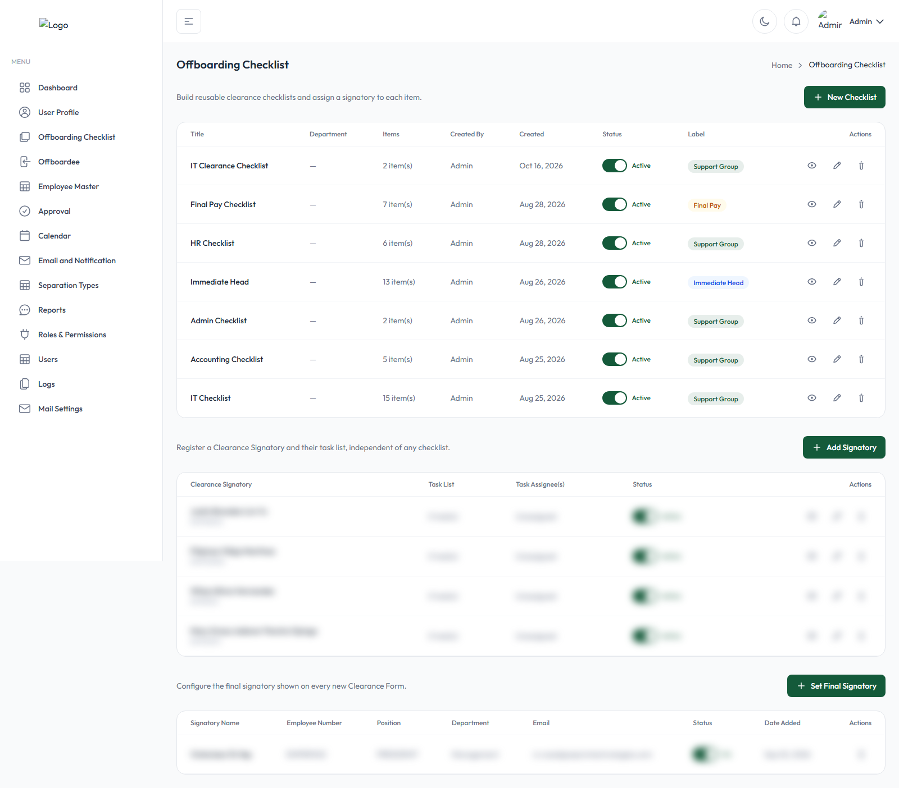

The page has three sections:

#### Checklists
Click **"New Checklist"** (or **Edit** on an existing card) to open the template form:

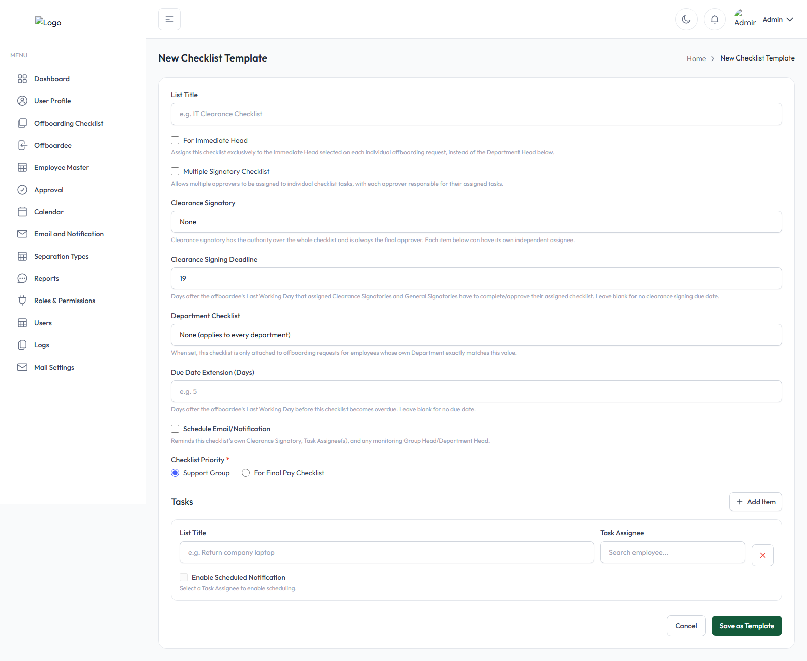

| Field | What it does |
|---|---|
| **List Title** | The checklist's name, e.g. "IT Clearance Checklist." |
| **For Immediate Head** (checkbox) | Assigns this checklist to the offboarding request's own Immediate Head instead of a department group. |
| **Multiple Signatory Checklist** (checkbox) | No single Clearance Signatory — each item is signed off by its own Task Assignee instead (see below). |
| **Clearance Signatory** | Pick an Employee Master group; that group's Group Head becomes the person who gives final approval on this checklist. |
| **Clearance Signing Deadline** | Days after the offboardee's Last Working Day the signatory has to sign (defaults to 19). |
| **Department Checklist** | Restrict this checklist to one specific department, or leave as "None" so it applies to every department. |
| **Due Date Extension (Days)** | Days after Last Working Day before this checklist becomes overdue. *Leaving it blank makes the checklist due exactly on the Last Working Day itself — it does not mean "no due date."* |
| **Schedule Email/Notification** | Optional automatic reminder emails for this checklist — pick a template, how many days before the due date, and (optionally) a repeat interval. |
| **Checklist Priority\*** | "Support Group" (the normal option) or "For Final Pay Checklist" — a Final Pay checklist only attaches once every other checklist and General Signatory on the request is already approved. |
| **Tasks** | Click **"Add Item"** for each clearance task; optionally assign a specific **Task Assignee** to that one item. |

Click **"Save as Template"** (or **"Update Template"**).

**Standard checklist vs. Multiple Signatory Checklist:**
- A **standard checklist** has one designated **Clearance Signatory** (the group's Group Head, or the request's Immediate Head) who personally reviews every item and clicks the final **Approve**.
- A **Multiple Signatory Checklist** has no single owner — each item is completed and effectively "signed" by its own individual Task Assignee, and the checklist approves **itself automatically** the moment every item is checked (with that assignee's own head approving behind the scenes where required). Nobody clicks a final Approve button on this type.

#### General Signatory
A General Signatory is configured once and automatically attaches to **every** offboarding request, independent of any specific checklist or department:
1. Click **"Add Signatory."**
2. Search and select the **Clearance Signatory** — any employee, not limited to group heads.
3. Set the **Clearance Signing Deadline** (defaults to 19 days).
4. Choose **Checklist Priority** — "Core" or "For Final Pay Checklist."
5. Optionally add **Task List** rows — informational only; a General Signatory can approve regardless of whether their listed tasks are checked off.
6. Click **Save**.

#### Final Approver
This is where you configure who gives the very last sign-off on every completed offboarding case — see [§3, Step 8](#3-the-complete-offboarding-process-step-by-step) for when this is actually used. Click **"Set Final Signatory,"** fill in their details, and use the row's Active/Inactive switch to control which configured signatory is currently in effect. **An offboarding request cannot even be created unless an active Final Approver is configured here first.**

How configuration affects new requests: when a request is created, every active, department-matching checklist and every active General Signatory is attached to it automatically — this is explained in full in [§3, Step 3](#3-the-complete-offboarding-process-step-by-step).

---

### D. Offboardee

**Purpose:** Create new offboarding requests and manage every request currently in progress.
**Access:** Menu item **Offboardee** (needs `offboardees.view`); creating a request needs `offboarding-requests.create`; retracting needs `offboarding-requests.cancel`; extending needs `checklists.extend-due`.

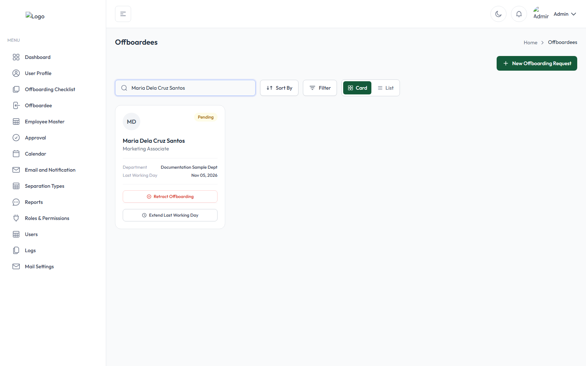

**Viewing the list:** search by name, sort by Newest/Oldest Created, and filter by Status (Pending/In Progress/Overdue/Completed/Retracted) or Department. Lists of 20+ requests automatically switch to a compact table view.

**Creating a new offboarding request** — click **"New Offboarding Request"**:

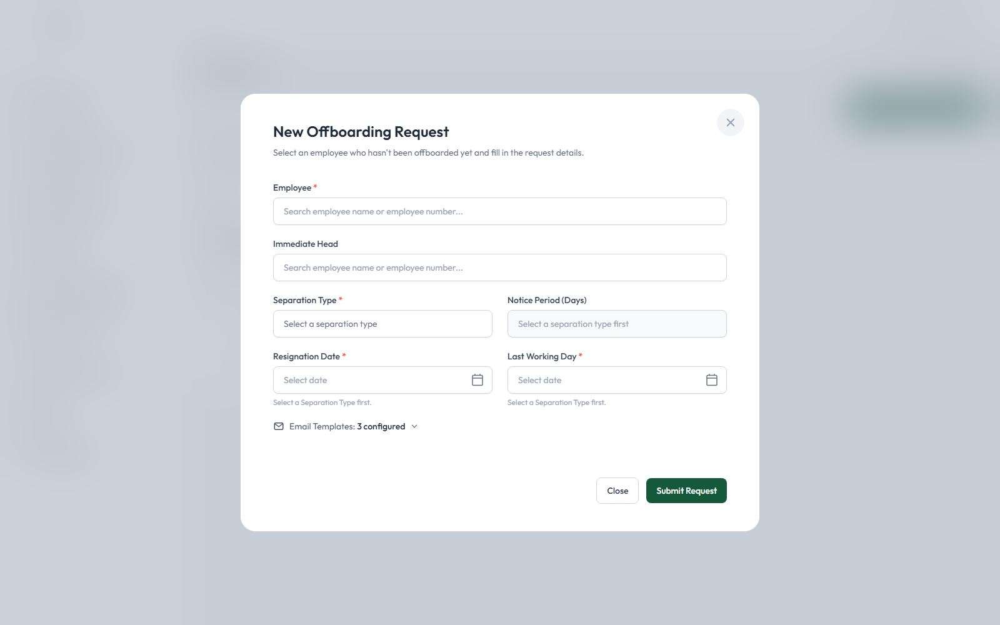

1. **Employee\*** — search and select an *active* employee (only employees not already mid-offboarding can be picked).
2. **Immediate Head** — auto-filled from the employee's own record if one is on file; you can change it.
3. **Separation Type\*** — choose one; its written policy description appears automatically.
4. **Resignation Date\*** and **Last Working Day\*** — Last Working Day is suggested automatically (Resignation Date + the Separation Type's Notice Period) but you can override it with any date.
5. Optionally expand **Email Templates** to override which template is used for the Department Head, Offboardee, or General Signatory notification.
6. Click **"Submit Request,"** then confirm.

**Request-level restrictions, verified from the actual code (do not assume these are always available):**
- **Retract** (button: **"Retract Offboarding"**) only appears while the Last Working Day hasn't passed yet **and** no checklist on the request has been approved yet. A written reason is always required, and this action can never be undone once confirmed — the request becomes a permanent, read-only record (nothing is deleted).
- **Extend Last Working Day** only appears while at least one checklist is still pending with a due date — it does **not** need to already be overdue. The new date must be strictly later than the current one; a written reason is required.

**Monitoring a request:** click any card to open the **Offboarding Status/Timeline** window:

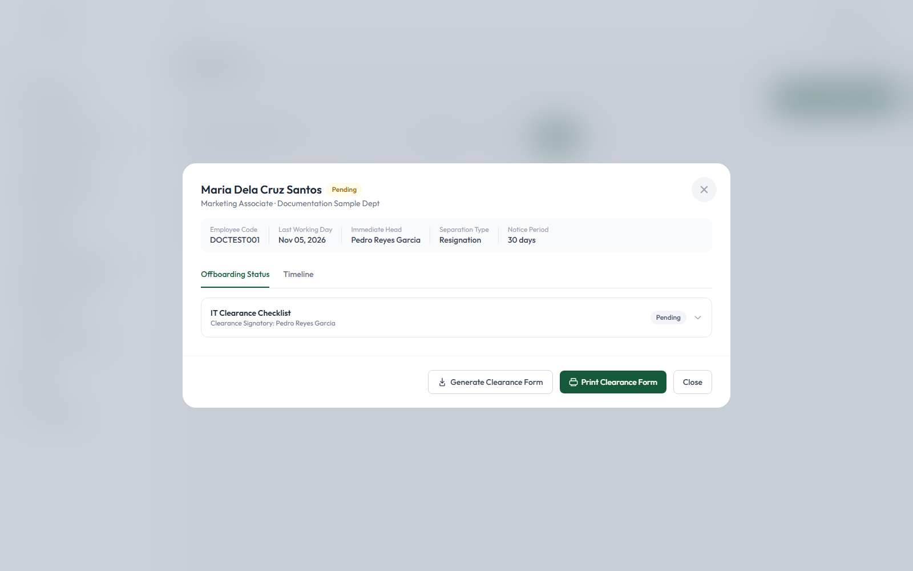

- **"Offboarding Status" tab** — one row per checklist/General Signatory, each with its own status badge; expand a row for assigned dates, who first viewed it, hold history, and remarks. Admins also see a **"Notify Approver"** button here to manually resend a reminder.
- **"Timeline" tab** — the complete chronological history of the request.

---

### E. Employee Master

**Purpose:** The single source of truth for every employee record — used throughout the rest of the application for offboarding requests, task assignment, and signatory selection.
**Access:** Menu item **Employee Master** (needs `employee-master.view`; creating `.create`, editing `.edit`, deleting `.delete`).

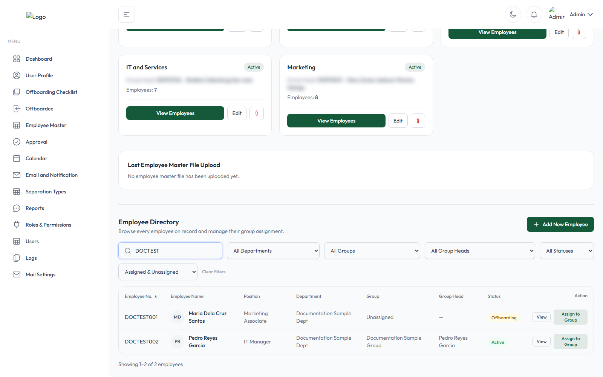

**Uploading an employee master file:** click **"Upload Excel"** and choose an `.xlsx`/`.xls` file.

> **This replaces the entire roster.** Confirming "Upload & Replace" means **any employee not listed in the uploaded file is permanently deleted.** Always verify the file is complete first.

The header row must contain exactly: `employeeNo, lastName, firstName, middleName, position, department, email, personalEmail, supOne, supTwo, head, headID` (any order). The import is **all-or-nothing** — a single bad row blocks the entire file, with the exact row-by-row errors shown.

A card near the top of the page always shows the **most recent upload's** File Name, Uploaded date/time, Uploaded By, Upload Status (Successful/Failed), Total Records, Successfully Imported, Skipped/Duplicate, and Failed counts. Manually adding one employee never changes what this card shows.

**Manually adding one employee** — click **"Add New Employee"**:

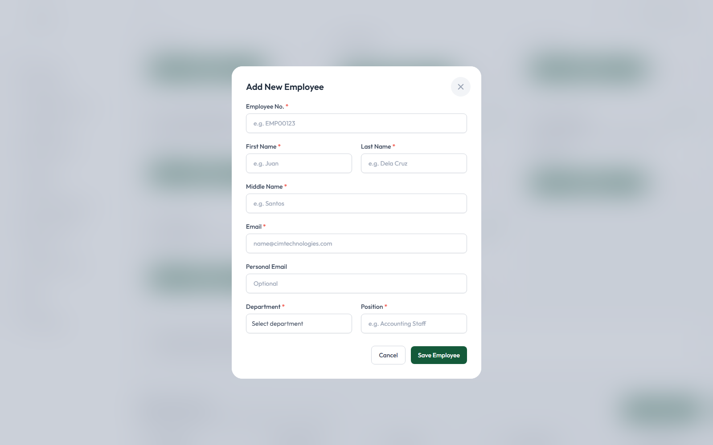

Employee No., First/Last/Middle Name, Email, Department, and Position are all required. **The system checks for a duplicate person by name** — even under a different employee number — before allowing the save: *"An employee with the same name already exists in the system. Please verify the employee details before proceeding."*

**Groups:** each Employee Master group has a **Group Head**. "Auto-Add Group Members" (ticked by default when creating/editing a group) automatically moves every employee in that head's department into the group. A new employee with no group assigned shows as **Unassigned**; you can assign them via **"Assign to Group"** on any row.

---

### F. Approval

**Purpose:** Monitor every checklist and signatory assignment across the entire organization, not just your own.
**Access:** Menu item **Approval** (needs `approvals.view`). **As an Admin, you see every checklist and General Signatory assignment system-wide** — a regular Approver only sees their own.

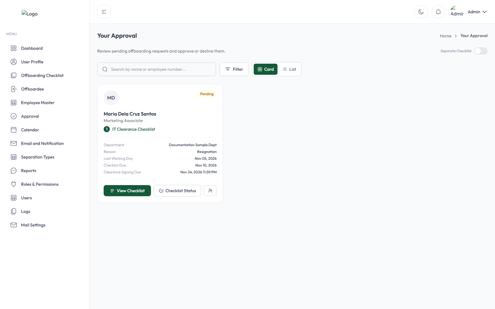

Use the **Search** box (by name or employee number), the **Filter** dropdown (Status / Department / Checklist Title), and the **Card/List** view toggle to find a specific case among every assignment in the system. Click any card to open its checklist (or, for a General Signatory/Final Approval card, its **"Review & Approve"** detail window) and see exactly the same information the assigned signatory themselves would see — status, due dates, items, and remarks.

**What Admin can do here vs. what's restricted to the designated approver:** an Admin can view every card and its full detail, and can reassign a checklist or item the same way a Clearance Signatory can — but giving the actual **Approve**/**Decline** for a checklist, or approving a **General Signatory** assignment, still follows the same rule as for anyone else: only that specific checklist's own Clearance Signatory (or an Admin acting on their behalf) can do it. The different roles — Clearance Signatory, Immediate Head, General Signatory, regular Task Assignee — are explained in full in the [Glossary](#4-status-definitions-and-terminology) below.

---

### G. Calendar

**Purpose:** A read-only, automatically-generated visual overview of every offboardee's Last Working Day.
**Access:** Menu item **Calendar** (needs `calendar.view`). *(Note: the page's own on-screen heading is spelled "Calender" — a typo in the application itself, not an error in this manual.)*

> **Screenshot not included:** the Calendar page has no admin-side filtering of any kind, and always displays every current/recent offboarding case's real employee name with no way to scope it down to sample data alone — capturing it would unavoidably expose real personal information, which this manual does not do. See [`screenshots/README.md`](screenshots/README.md) for the full list of omitted screenshots and why.

**What appears on it:** one event per employee who has any offboarding request (using their **most recent** request), placed on that request's **Last Working Day**. The event shows the employee's real name, so treat anything on this page the same way you would any other page containing personal employee data. A retracted request's event is shown in red with a "Retracted" badge; every other event carries a small "Notice: Upcoming / Today / Past" badge based on the request's Notification Date.

**Navigating:** use the **prev/next arrows** and the **Month / Week / Day** view buttons across the top. There is no "Today" shortcut button and no list view.

**Clicking an event** opens the same Offboarding Status/Timeline window used elsewhere in the app, but showing only its **Timeline** tab (the "Offboarding Status" tab is not available from here).

The Calendar is entirely **read-only** — there is no way to create, edit, drag, or filter events from this page; everything shown is generated automatically from existing offboarding requests.

---

### H. Email and Notification

**Purpose:** Control the wording of every system email.
**Access:** Menu item **"Email and Notification"** (needs `email-templates.view`; `.create`/`.edit`/`.delete` for changes).

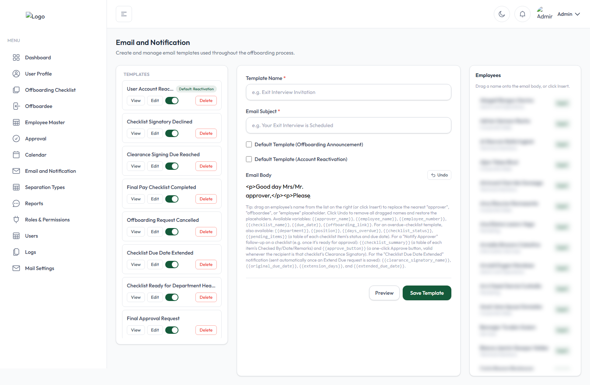

1. Click **"New Template"** (or edit an existing card).
2. Fill in **Template Name\*** and **Email Subject\***.
3. Optionally mark it as the **Default Template** for Offboarding Announcements or Account Reactivation (only one template can hold each flag at a time).
4. Write the **Email Body** in the rich-text editor — drag an employee's name from the right-hand panel onto the body, or click **Insert**, to replace a placeholder.
5. Click **Preview**, then **Save Template**.

Available placeholders include `{{employee_name}}`, `{{employee_number}}`, `{{checklist_name}}`, `{{due_date}}`, and `{{offboarding_link}}`, plus several more that only apply to specific automated emails (the page's own help text lists which placeholders apply to which event).

> **Several system emails are matched by their exact Template Name.** Renaming or deactivating one of the pre-installed system templates (e.g. "Offboarding Request Notification," "Checklist Due Date Extended," "Final Pay Checklist Completed") silently stops that specific notification from sending. Treat template names as fixed identifiers, not just display text.

**Email vs. in-app notifications:** most of the system's notifications are sent by email only. A small number of events (e.g. an overdue checklist, a clearance-signing deadline being reached) also raise an in-app notification visible to the relevant user inside the application itself, in addition to the email.

**When notifications actually fire** (verified from the code, not assumed): request creation, checklist assignment/reassignment, a checklist becoming ready for approval, a checklist being declined, a request being retracted, a Last Working Day extension, overdue checklists, clearance-signing deadlines, and final completion. Each of these is described at the point it happens in [§3](#3-the-complete-offboarding-process-step-by-step).

---

### I. Separation Type

**Purpose:** Maintain the list of separation reasons (Resignation, Retirement, etc.) offered when creating a new offboarding request.
**Access:** Menu item **Separation Types** (needs `separation-types.view`; creating/editing/deleting need the matching `.create`/`.edit`/`.delete` permissions).

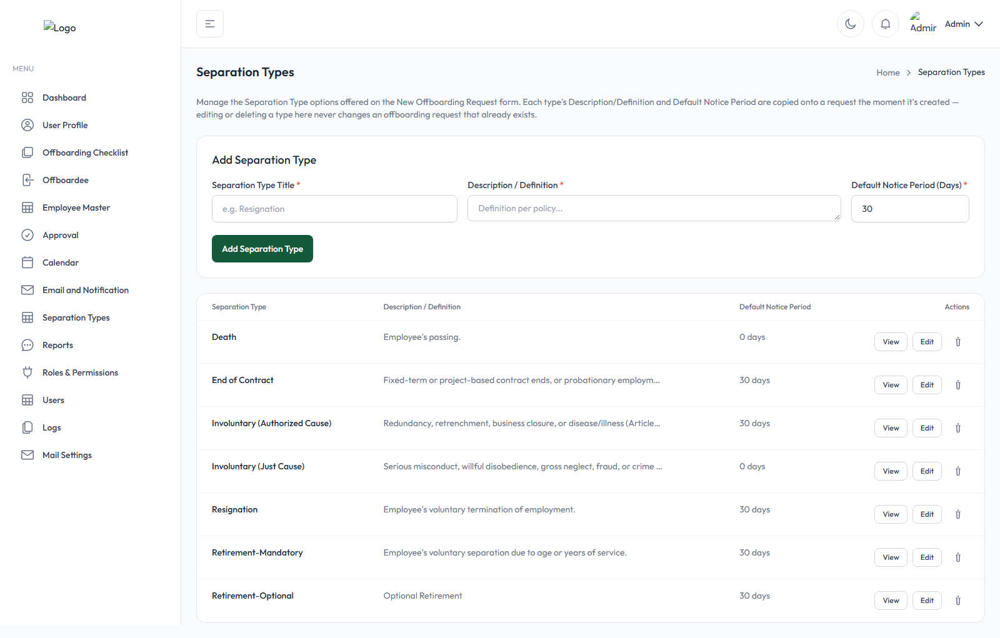

The page's own description explains its purpose precisely: *"Each type's Description/Definition and Default Notice Period are copied onto a request the moment it's created — editing or deleting a type here never changes an offboarding request that already exists."*

**Creating one:**
1. Under **"Add Separation Type,"** fill in **Separation Type Title\*** (must be unique), **Description / Definition\*** (shown to the admin as the policy text when this type is selected on the request form), and **Default Notice Period (Days)\*** (defaults to 30).
2. Click **"Add Separation Type."**

Use **View** to see a type's full text, **Edit** to change any of the three fields, or the trash icon to delete one — deleting never affects any offboarding request that already used it.

**How a Separation Type's values actually get used elsewhere** (this goes well beyond just the Notice Period default):
- Its **Title** becomes the new request's stored "reason," which also fills the `{{reason}}` placeholder in outgoing notification emails.
- Its **Description** becomes that request's own frozen "Definition per Policy" text.
- Its **Default Notice Period (Days)** sets both the Last Working Day suggestion *and* the request's **Notification Date** (creation date + this many days) — which is what drives the Calendar's "Notice: Upcoming/Today/Past" badge.
- It also appears as a **filter and grouping option on the Reports page**, including an entire report ("Completion Rates by Separation Type") built around it.

Because every one of these values is **copied onto the request at the moment it's created**, changing a Separation Type's description or notice period later only affects *future* requests, never ones already in progress.

---

### J. Reports

**Purpose:** Generate filtered, exportable reports on offboarding activity.
**Access:** Menu item **Reports** (needs `reports.view`).

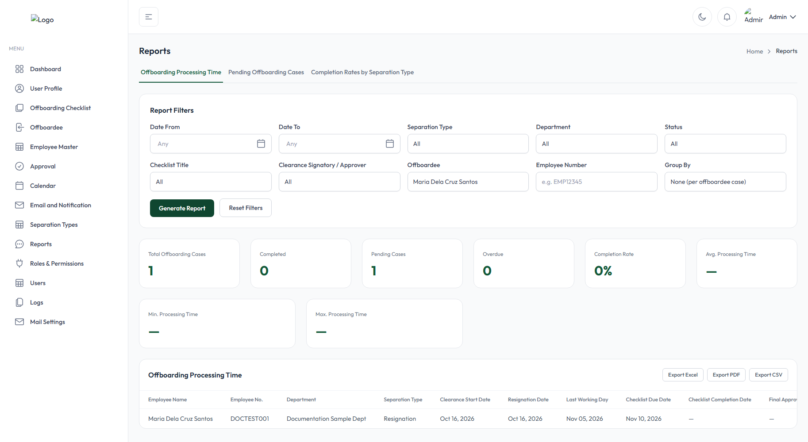

> **Note on report names:** this application actually provides **three** report types, not four. There is no separate "All Offboarding Requests" report — the closest equivalent is the **Offboarding Processing Time** report with **Group By** set to "None (per offboardee case)" and **Status** set to "All," which lists one row per case (open and closed alike). The three real reports, shown as tabs at the top of the page, are:
> 1. **Offboarding Processing Time**
> 2. **Pending Offboarding Cases**
> 3. **Completion Rates by Separation Type**

**Filters** (apply across all three tabs): Date From/To (filters by request creation date), Separation Type, Department, Status, Checklist Title, Clearance Signatory/Approver, Offboardee (name), and Employee Number. Click **"Generate Report"** to run it, or **"Reset Filters"** to clear everything.

#### 1. Offboarding Processing Time
**Purpose:** Measure how long offboarding cases are taking.
Set **Group By** to **"None"** for one detailed row per case (Employee, Department, Separation Type, every key date from Clearance Start through Offboarding Completion, Total Processing Time, and Current Status) — or group it by **Offboardee, Department, Checklist,** or **Separation Type** for summarized averages (Total Cases, Completed, Avg./Min./Max. Processing Time) per group instead.

#### 2. Pending Offboarding Cases
**Purpose:** See exactly which cases are still open and what's holding each one up.
Only includes requests still Pending or In Progress. Columns include the employee, which checklist stage it's currently waiting on, a "N/M cleared" checklist progress count, who the assigned signatory is, the due date, how many days it's been pending, and whether it's currently Overdue.

#### 3. Completion Rates by Separation Type
**Purpose:** Compare how different separation reasons perform.
One row per Separation Type: Total Cases, Completed, Pending/In Progress, Overdue, Completion Rate (%), and Average Processing Time (days). Retracted cases are excluded from this report.

**Exporting:** every report can be exported as **Excel, PDF,** or **CSV** via the buttons above the results table — each export uses whatever tab and filters are currently applied, and contains the same columns shown on screen.

---

### K. Roles and Permissions

**Purpose:** Control exactly which actions each role can perform.
**Access:** Menu item **Roles & Permissions** (needs `roles.view`; changes need `roles.manage`).

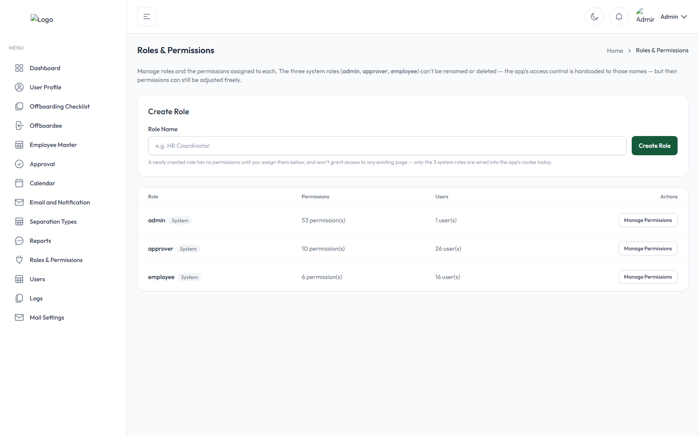

The three built-in roles — **admin, approver, employee** — can have their permissions freely adjusted, but their **names cannot be changed or deleted**, since the application's access control is hardcoded to those three names.

1. Under **"Create Role,"** type a **Role Name** and click **Create Role** — it starts with no permissions at all.
2. Click **"Manage Permissions"** on any role's row, tick every permission that role should have (grouped by module), and click **Save Permissions** — this **replaces** the role's entire permission list with exactly what's ticked.

A role currently assigned to any user account cannot be deleted until those users are reassigned to a different role.

**How roles relate to accounts:** permissions are attached to roles, and a user account can hold one or more roles — they get everything those roles allow, combined. Whether a sidebar menu item or a specific button even appears to a given user is controlled directly by their role's permissions (see [§L](#l-users) for how roles get assigned to individual people).

---

### L. Users

**Purpose:** See every employee's account status, assign roles, and reactivate blocked accounts.
**Access:** Menu item **Users** (needs `users.view`); role changes need `users.manage-roles`; reactivation needs `users.manage-status`; "Login As User" needs `users.login-as`.

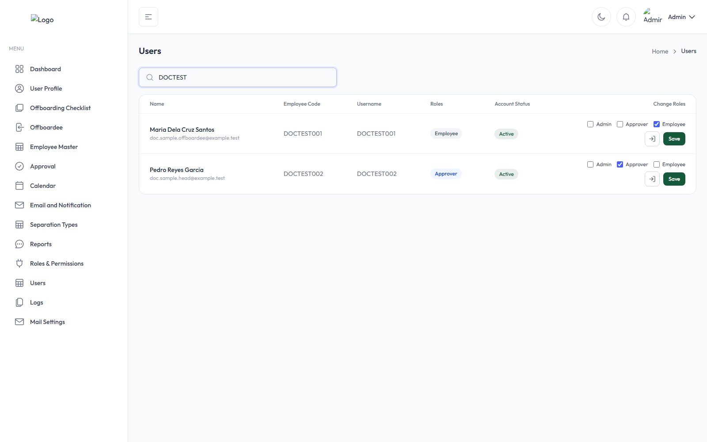

The page lists **every employee in Employee Master**, whether or not they have a login account yet.

**Account status, exactly as the application defines it:**
- **Active** — the employee has a login account and it is not currently blocked.
- **Inactive** — covers *two distinct underlying situations* that the badge itself does not visually separate: (1) the employee simply has **no login account yet** at all, or (2) the employee has an account but it is **currently blocked** (three failed login attempts). You can always tell which case you're looking at because a genuinely blocked account additionally shows **"Blocked {date/time}"** and a **"Reactivate"** button right under the badge — an employee who just doesn't have an account yet shows neither of those, and their Username column instead reads *"Not yet created — will use {employee code}."*

**Changing someone's role(s):** tick/untick the role checkboxes in their row (at least one must stay ticked) and click **Save**, then confirm. If the employee had no account yet, one is created automatically at this moment, and a **"User Account Created"** pop-up shows their Initial Password **one time only** — share it with them immediately, since it is never shown again.

**Reactivating a blocked account:** click **"Reactivate,"** review the shown details, optionally pick a different notification email template, and confirm. This clears the block, generates a brand-new random temporary password (sent only by email, never shown on screen), and flags the account to require a password change on next login.

**"Login As User":** click the icon with the tooltip **"Login As User"** (only available for accounts that already exist) to open a new browser tab signed in as that person — useful for troubleshooting what they're seeing. An amber banner on every page reminds you (and them, if they're also logged in elsewhere) that this is an impersonation session, with a **"Return to My Account"** button to end it. You cannot impersonate your own account, a blocked account, or start a second impersonation while already impersonating someone.

---

### M. Logs

**Purpose:** A complete, read-only history of authentication and account activity.
**Access:** Menu item **Logs** (needs `logs.view`).

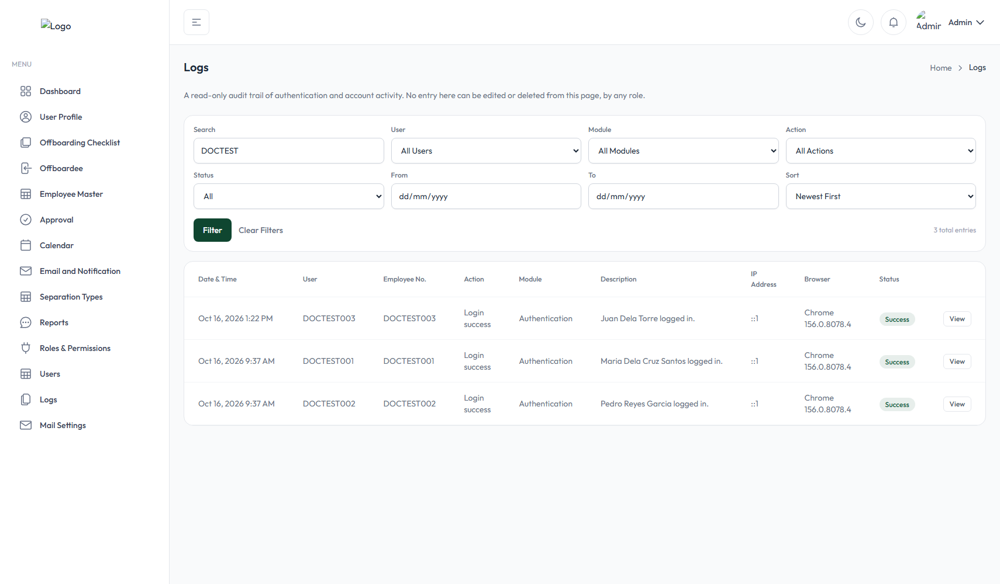

Each entry records: who performed the action (name and username), the employee number involved (if applicable), the exact action and which module it belongs to, a plain-English description, status (Success/Failed), IP address, browser, and platform. Filter by **Search** (name/username/employee no./action/description), **User, Module, Action, Status,** and a **From/To** date range; sort Newest/Oldest First.

**No entry on this page can ever be edited or deleted by any role, Admin included** — it exists purely as an audit trail.

> One known display issue: the detail window's "Login Time" and "Session Duration" fields never populate for a successful login, due to an internal naming mismatch in how that one specific event is recorded. The rest of every entry's detail is accurate and unaffected.

---

### N. Mail Settings

**Purpose:** Configure the SMTP server the application uses to actually send its emails.
**Access:** Menu item **Mail Settings** (needs `smtp-settings.view`; changes need `.manage`; test buttons need `.test`).

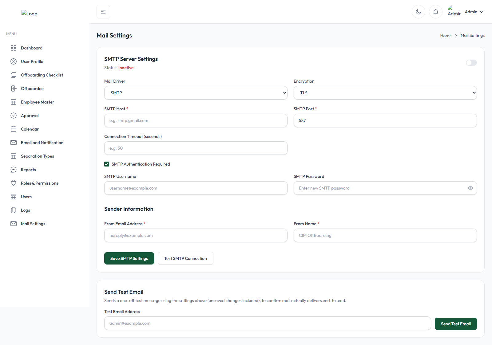

1. Choose a **Mail Driver** — SMTP is the normal choice for real delivery.
2. Fill in **SMTP Host\*** and **SMTP Port\*** (587 is the typical default), and choose an **Encryption** method — None, TLS, or SSL.
3. If your mail server requires a login, tick **"SMTP Authentication Required"** and fill in **SMTP Username** and **SMTP Password**. (If a password was already saved, the field shows as dots with a **"Change Password"** option — leaving it untouched keeps the existing password.)
4. Optionally set a **Connection Timeout (seconds)**.
5. Fill in **From Email Address\*** and **From Name\*** — these appear as the sender on every email the system sends.
6. Switch **Status** to **Active**, then click **"Save SMTP Settings."**

**Testing:** click **"Test SMTP Connection"** to check connectivity without sending anything, or enter an address under **"Send Test Email"** and click **Send Test Email** to receive an actual message.

> **Known issue, verified in the code:** both test buttons currently send only the connection fields and omit From Email/From Name — fields the server's validation requires on *every* save, test requests included. As a result, both buttons are likely to report failure (e.g. "Connection Failed" / "Send Failed") even when your SMTP settings are otherwise completely correct. Until this is corrected, confirm real delivery by triggering an actual application notification instead of relying on these two buttons.

These settings only take effect while **Status** is Active; otherwise the server's own underlying default mail configuration is used instead. **Never share or screenshot a real SMTP password** — the field is masked by the interface itself, but avoid typing a real production password into any copy of this manual.

---

## 3. The complete offboarding process, step by step

### Step 1 — Prepare the required configuration

Before creating your very first offboarding request, make sure the following are set up. Items marked **Mandatory** will actually block request creation if missing; items marked **Optional** simply won't apply to that request if skipped.

| Configuration | Required? | Why |
|---|---|---|
| **Employee Master records** | Mandatory | You can only select an employee who already exists and is Active (see [§E](#e-employee-master)). |
| **An active Final Approver** | Mandatory | The system refuses to create *any* request at all without one active Final Approver configured somewhere (see [§C](#c-offboarding-checklist)). |
| **Separation Types** | Mandatory (at least one) | The request form requires picking one. |
| **Checklist templates** | Optional, but practically essential | A request with no matching checklists will have nothing for anyone to clear — but the system doesn't block you from creating one. |
| **Department Heads / Group Heads / General Signatories** | Optional | Only relevant if you've configured checklists or General Signatories that depend on them. |
| **Task assignments on checklist items** | Optional | Items left unassigned simply have no default Task Assignee until someone is assigned later. |
| **Email templates** | Optional, but strongly recommended | Several system notifications are matched by exact template name — if the relevant one is missing, that specific email is silently skipped (logged, but no error shown to anyone). |
| **SMTP / Mail Settings** | Optional | Without a working mail configuration, every notification email above fails to send — the rest of the workflow still proceeds normally in-app. |

### Step 2 — Create a new offboarding request

1. Open the **Offboardee** page (or click **"New Offboarding Request"** directly from the Dashboard).
2. Click **"New Offboarding Request."**
3. Search for and select the **Employee**.
4. Confirm or change the auto-filled **Immediate Head**.
5. Select the **Separation Type** — its policy description appears automatically.
6. Review the auto-filled **Notice Period (Days)** (read-only, from the Separation Type).
7. Set the **Resignation Date**.
8. Set or verify the **Last Working Day** — it is auto-suggested from the Resignation Date and Notice Period but can be freely overridden.
9. Review everything, including any Email Template overrides you want to set.
10. Click **"Submit Request,"** then confirm **"Create Offboarding Request?"**
11. Verify success — the toast confirms *"Offboarding request submitted,"* and the new card appears on the Offboardee page with status **Pending**.

### Step 3 — Checklist generation and assignment

The moment the request is created, the system automatically works out which checklists and General Signatories apply and attaches them — you do not manually assign the "first round" yourself:

- Every **active checklist template** whose Department field is blank, or exactly matches the offboardee's own department, is attached.
- Every **active General Signatory** is attached, independent of department.
- Each checklist's **Clearance Signatory** is resolved automatically from its own configuration — the relevant Employee Master group's **Group Head**, or (for an "For Immediate Head" checklist) the request's own **Immediate Head**.
- A checklist marked **"For Final Pay Checklist"** is deliberately **not** attached at this point — it only attaches once every other checklist and General Signatory is fully approved.

**The people involved, and how their roles differ:**

| Role | What they're responsible for |
|---|---|
| **Clearance Signatory / Department Head** | The one person with final authority over a standard checklist — reviews every item and personally clicks the final Approve. |
| **Immediate Head** | Same authority as a Clearance Signatory, but specifically for a checklist flagged "For Immediate Head" — resolved from whoever was picked (or auto-filled) as that request's Immediate Head. |
| **General Signatory** | A completely separate, company-wide approval track attached to every request — not tied to any specific checklist. |
| **Regular Approver / individual Task Assignee** | On a **standard** checklist, completes the specific item(s) assigned to them, but relies on the Clearance Signatory for the actual final approval. |
| **Final Signatory** | Gives the very last sign-off, only after the entire request reaches Completed status (see Step 8). |

**Standard checklist vs. Multiple Signatory Checklist:** a standard checklist has one Clearance Signatory who personally approves the whole thing. A **Multiple Signatory Checklist** has no single owner at all — each item is independently signed off by its own Task Assignee, and the checklist approves **itself automatically** the instant every item is checked (with that assignee's own head approving behind the scenes if required). Nobody clicks a final "Approve" button on this type.

### Step 4 — Email and in-app notifications

| Event | Who is notified | Template used |
|---|---|---|
| Request created | Department Heads/Clearance Signatories of every attached checklist, the offboardee, and every attached General Signatory | "Offboarding Request Notification" (signatories), the offboardee's own announcement template, "General Signatory Offboarding Notification" |
| A checklist becomes fully checked and ready for the Clearance Signatory's final approval | That checklist's Clearance Signatory | "Checklist Ready for Department Head Approval" |
| A checklist is declined (placed on hold) | The request's creator | "Checklist Signatory Declined" |
| A Multiple Signatory Checklist item needs head sign-off | The relevant head | "Checklist Item Pending Head Approval" |
| A checklist or clearance-signing due date is reached | The responsible signatory (and, for an overdue checklist, every Admin too) | "Offboarding Overdue Notice" / "Clearance Signing Due Reached" |
| Last Working Day extended | The signatories of every checklist whose due date just changed | "Checklist Due Date Extended" |
| Request retracted | The offboardee, Immediate Head, every Clearance Signatory, and every Task Assignee | "Offboarding Request Cancelled" |
| All regular checklists + General Signatories approved (Final Pay stage begins) | The Final Pay checklist's Clearance Signatory | "Final Pay Checklist Approval" |
| Request fully Completed | Every Admin, plus the request's creator (with the combined Clearance Form + Timeline PDF attached) | "Final Pay Checklist Completed" |
| Final Approval sent | The configured Final Signatory | "Final Approval Request" |

**A notification is silently skipped** (not shown as an error to anyone) if its named email template is missing or has been deactivated — the event itself still happens normally; only the email doesn't go out. **This manual does not claim an email was actually delivered** — only that the application attempted to send it; delivery itself depends on your SMTP configuration (see [§N](#n-mail-settings)) and the hosting server's background task scheduler actually running. Check the **Logs** page ([§M](#m-logs)) for evidence of what was actually recorded.

### Step 5 — Approver and Task Assignee actions

Each assigned person opens their own **Approval** page and works through their checklist:
1. **Review** the checklist item(s) assigned to them.
2. **Check off** an item, optionally adding a **remark**.
3. **Save Progress** to record partial work without finishing the whole checklist yet.
4. If something is blocking a specific item, click **Hold** instead (a written remark is required).
5. Once every item on a standard checklist is checked, the Clearance Signatory clicks **Approve** (remarks become *required* if the checklist's due date has already passed) — or clicks **Decline** instead, which places the entire checklist On Hold with a required reason.
6. A Clearance Signatory can **reassign** an item or an entire checklist to a different eligible employee at any point before it's approved.

Each of these actions moves the checklist's own status forward (Pending → In Progress → Approved, or → On Hold if declined) — see [§4](#4-status-definitions-and-terminology) for exactly what each status badge means.

### Step 6 — Monitor offboarding progress

Use these pages together to track where any case stands:
- **Dashboard** ([§A](#a-dashboard)) — organization-wide counts and trends.
- **Offboardee page** ([§D](#d-offboardee)) — per-request status, with the full Status/Timeline window available on every card.
- **Approval page** ([§F](#f-approval)) — every individual checklist/signatory assignment, system-wide.
- **Reports** ([§J](#j-reports)) — the Pending Offboarding Cases report specifically highlights exactly what's holding up every still-open case.

A request's overall status becomes **Overdue** the moment any one of its checklists passes its due date without being approved — this is calculated automatically, not something anyone sets manually.

### Step 7 — Handle exceptions

| Situation | What to do |
|---|---|
| **A checklist was declined / placed on hold** | The Clearance Signatory (or an Admin) reviews the stated reason, resolves whatever's blocking it, then clicks **"Remove On Hold"** with their own reason — the checklist returns to Pending and can be acted on again. |
| **A task needs to go to someone else** | The checklist's Clearance Signatory (or an Admin) reassigns the whole checklist or just the one item from the Approval page (see [§F](#f-approval)). |
| **The request needs to be called off entirely** | **Retract** it from the Offboardee page — only possible while the Last Working Day hasn't passed and no checklist has been approved yet; a reason is required, and the action is permanent (though nothing is actually deleted — it becomes a read-only record). |
| **The Last Working Day needs to move** | **Extend Last Working Day** from the Offboardee page — only forward, never backward; a reason is required; every still-pending checklist's due date recalculates automatically. |
| **An email notification failed to send** | Check the **Logs** page for the related entry, confirm the named email template exists and is active, and confirm Mail Settings are correctly configured — see [§5, Troubleshooting](#5-common-errors-and-troubleshooting). |
| **A checklist can't be approved — "all items must be checked"** | Every single item on that checklist must be checked off before the final Approve button will work — there is no partial approval of a checklist. |

### Step 8 — Final Approval and clearance documentation

**The condition for completion:** a request's status becomes **Completed** only once **every** regular checklist, **every** Final Pay checklist, and **every** General Signatory (including their own Final Pay tier) has been approved. Approving one checklist, even the last *visible* one, does **not** by itself complete the request if a General Signatory assignment or a Final Pay checklist is still outstanding — all of them must clear.

**Sending Final Approval** (only once the request shows Completed):
1. On the Offboardee page, click **"Final Approval"** (or **"Resend Final Approval"** if one is already pending).
2. Confirm.

The configured Final Signatory is emailed the Clearance Form attached, and also receives a card on their own Approval page — either path lets them give approval.

**When a signature actually appears on the Clearance Form** — this is the single most commonly misunderstood rule, so read it carefully:
- Each signatory gets **one merged row**, which can represent **more than one** responsibility they hold on that request (e.g. they might be a Clearance Signatory on one checklist *and* a Task Assignee on another, *and* a General Signatory — all combined into their one row).
- Their signature image only appears once **every single one** of those responsibilities is fully cleared — not just the most recent one you approved. Until then, their row shows "In Progress" or "Pending" with no signature, even if they already cleared several of their own checklists.
- The **Immediate Head's** row is the one exception — it depends only on their own Immediate Head checklist, regardless of any other role they separately hold.
- The **Final Approver's** signature only appears once their own Final Approval is actually given — not merely once the request reaches Completed.
- Nobody's signature can appear at all unless they've uploaded an e-signature on their own User Profile ([§B](#b-user-profile)).

**Viewing/generating the Clearance Form:** available at **any stage** of the process, not only once Completed — click **"Generate Clearance Form"** (opens inline in a new tab) or **"Print Clearance Form"** (opens a print-ready page) from the Status/Timeline window. A combined Clearance Form + full Offboarding Timeline PDF is also generated automatically and emailed once the request reaches Completed — that specific combined version is attachment-only; there is currently no button to view or re-download it on demand.

See also [`offboarding-workflow.md`](offboarding-workflow.md) for a diagram-first version of this same process.

---

## 4. Status definitions and terminology

### Glossary

| Term | Meaning |
|---|---|
| **Clearance Signatory** | The one person with final authority over an entire standard checklist. |
| **Immediate Head** | Either the offboardee's own recorded head (from their Employee Master record), or — separately — whoever is set as the Immediate Head on one specific offboarding request; the latter is who signs that request's "For Immediate Head" checklist. |
| **General Signatory** | A company-wide signer attached automatically to every offboarding request, independent of department or checklist configuration, with their own independent Approve/Decline action. |
| **Task Assignee** | The person responsible for one specific checklist item. |
| **Multiple Signatory Checklist** | A checklist with no single Clearance Signatory — each item is signed off by its own Task Assignee, and the whole checklist self-approves once every item is done. |
| **Final Pay Checklist** | A checklist that only attaches once every other checklist and General Signatory on the request is approved; completing all Final Pay checklists (plus the General Signatories' own Final Pay tier) is what moves the request to Completed. |
| **Final Approver / Final Signatory** | The person who gives the very last sign-off, only after the request is already Completed. |
| **Retract** | Internally named "Cancel" in the code and database, but always labelled **"Retract"** in the interface — a permanent, read-only closure of a request; nothing is deleted. |
| **Extend Last Working Day** | Moves a request's Last Working Day forward (never backward) and recalculates every still-pending checklist's due date from the new date. |
| **Notification Date** | A date calculated automatically (request creation date + the Separation Type's Notice Period) — not shown on most pages, but drives the Calendar's "Notice" badges. |

### Status reference

**Offboarding Request status**

| Shown as | Meaning |
|---|---|
| **Pending** | Created; nothing actioned yet. |
| **In Progress** | At least one signatory has started acting on it. |
| **Overdue** | At least one checklist has passed its due date, unapproved. |
| **Completed** | Every checklist, Final Pay checklist, and General Signatory has been approved. |
| **Retracted** | Closed by an Admin; permanently read-only. (Stored internally as "Cancelled" — the Reports page's Status filter specifically still shows this option as "Cancelled.") |

**Checklist / signatory status**

| Shown as | Meaning |
|---|---|
| **Cleared / Completed / Approved** | Fully approved (different pages use slightly different wording for the same state). |
| **On Hold / Declined** | Paused — a Clearance Signatory declined it, or an individual item was placed on hold. In the current application, these always mean the same underlying "on hold" condition; a truly separate "Declined" state exists in the data model but nothing currently sets it. |
| **Overdue** | Past its due date, still not approved. |
| **In Progress** | Work has started on it. |
| **Pending** | Not yet started. |
| **Ready for Approval** | (General Signatory only) No task list configured for this signatory — nothing further is needed from anyone else before they can act. |
| **"Completed Late"** | Not a separate status — it's the same "Cleared/Completed" state, just flagged (in a red legend color, with the note "— Completed Beyond Deadline") because it was approved on or after its due date. |

**Employee status**

| Status | Meaning |
|---|---|
| **Active** | Not currently involved in any offboarding process. |
| **Offboarding** | Currently has an offboarding request in progress. |
| **Offboarded** | Completed the offboarding process. |

---

## 5. Common errors and troubleshooting

| You see... | What it means | What to do |
|---|---|---|
| "These credentials do not match our records." | Wrong username or password. | Double-check both; use Forgot Password if needed. |
| "Your account has been blocked because you reached the maximum number of failed login attempts..." | Three wrong attempts in a row. | Have an Admin reactivate the account from the Users page. |
| "No active Final Approver is configured..." | Nobody is set as the active Final Signatory. | Go to Offboarding Checklist → Final Approver, and set/activate one before creating the request. |
| "{name} already has an offboarding request in progress..." | That employee isn't currently Active. | Refresh the page; pick a different employee, or work with their existing request instead. |
| "This Employee No. is already registered in the system." | Duplicate Employee No. on Add New Employee. | Use a different, genuinely unused employee number. |
| "An employee with the same name already exists in the system..." | A name match was found under a different employee number. | Confirm you are not about to create a duplicate person. |
| "Missing required column(s): ..." (Excel upload) | The file's header row doesn't contain all 12 required columns. | Fix the header row exactly, then re-upload. |
| "A reason is required..." (Retract / Extend / Decline / Remove Hold) | These actions always require written justification. | Fill in the reason field before confirming. |
| "This offboarding request has already been retracted/completed and cannot be..." | The request is in a read-only state. | No further action is possible through that specific control. |
| Mail Settings test buttons always fail | Known application issue — see [§N](#n-mail-settings). | Verify delivery with a real notification instead. |
| An expected email never arrived | The template may be missing/renamed/inactive, or the server's background scheduler isn't running. | Check the Logs page for a related entry, check Email Templates, and ask your system administrator to confirm the scheduler is running. |

---

## 6. Frequently asked questions

**Q: Can an Employee create their own offboarding request?**
No. Only an Admin (or any custom role explicitly granted `offboarding-requests.create`) can create one. Employees can only view the progress of a request already created for them.

**Q: What's the difference between Retract and Cancel?**
There is no difference — internally the application calls this action "Cancel" (the route, database column, and status value are all literally named that), but the interface always labels it **"Retract"**.

**Q: Why can't I retract this particular request?**
Retract is only available while the Last Working Day hasn't passed yet *and* no checklist on the request has been approved. Once either condition is no longer true, the button disappears.

**Q: If I extend someone's Last Working Day, does everything reschedule automatically?**
Yes — every still-pending checklist's own due date is recalculated from the new Last Working Day immediately, and the responsible signatories are notified.

**Q: My SMTP test keeps failing even though my settings look correct — is something wrong with my mail server?**
Not necessarily — see the known issue documented in [§N, Mail Settings](#n-mail-settings). The test buttons themselves have a bug that causes them to fail validation regardless of your actual SMTP configuration.

**Q: Why does one employee's Clearance Form row still say "In Progress" even though I approved their checklist?**
A single row on the Clearance Form can represent *more than one* responsibility that same person holds (e.g. they might also be a Task Assignee on another checklist, or a General Signatory) — the row only shows cleared once **every** responsibility they hold on that request is finished, not just the one you just approved.

**Q: Can I undo an Upload Excel import after confirming it?**
No — there is no undo. This is exactly why the confirmation dialog explicitly warns that it replaces the entire roster; always double-check the file before confirming "Upload & Replace."

---

*This manual's companion files — the editable Markdown source, the full screenshot set, and instructions for keeping this documentation current — are indexed in [`README.md`](README.md).*
