# CIM OffBoarding — Approver User Manual

**Version:** 1.0 &nbsp;|&nbsp; **Revision date:** October 16, 2026

This manual is written for Clearance Signatories (Department Heads), Task Assignees, and General Signatories — anyone who signs in to CIM OffBoarding with the **Approver** account type to review and act on offboarding checklists. It was produced by directly exercising the running application (every screenshot is a real, step-by-step walkthrough using sample data) and by inspecting the underlying routes, controllers, and validation rules, so every instruction, button label, and message quoted here reflects what the application actually does today — not what it is assumed to do.

---

## Table of Contents

1. [Introduction](#introduction)
2. [Signing In to the Application](#signing-in-to-the-application)
3. [User Profile and Electronic Signature](#user-profile-and-electronic-signature)
4. [The Approval Module](#the-approval-module)
   - [4.1 Viewing Assigned Offboarding Requests](#41-viewing-assigned-offboarding-requests)
   - [4.2 Viewing Checklists and Task Lists](#42-viewing-checklists-and-task-lists)
   - [4.3 Assigning Tasks to Other Task Assignees](#43-assigning-tasks-to-other-task-assignees)
   - [4.4 Holding a Checklist](#44-holding-a-checklist)
   - [4.5 Removing an On-Hold Status](#45-removing-an-on-hold-status)
   - [4.6 Declining a Checklist](#46-declining-a-checklist)
   - [4.7 Approving a Checklist](#47-approving-a-checklist)
5. [Approving Checklists Through Email](#5-approving-checklists-through-email)
6. [Calendar Module](#6-calendar-module)
7. [Best Practices for Approvers](#7-best-practices-for-approvers)
8. [Glossary of Terms](#8-glossary-of-terms)

---

## Introduction

### Purpose of CIM OffBoarding

CIM OffBoarding is CIM Technologies' internal system for managing an employee's exit from the company from the moment a resignation (or other separation) is recorded until every clearance requirement has been signed off. It replaces a paper clearance form with a tracked, auditable digital workflow: checklists are automatically assigned to the right people, each action is logged with who did it and when, and the final Clearance Form is generated directly from that record.

### Purpose of this manual

This manual documents the **Approver** experience specifically. An Approver account is used by several different kinds of people in the workflow — a **Clearance Signatory** (usually a Department Head) who owns and signs off a checklist, a **Task Assignee** who is handed individual items within a checklist, and a **General Signatory** who gives a separate, company-wide clearance independent of any checklist. All of them sign in through the same "Approver" account type and the same three menu items; which of these roles applies to you on a given offboarding request depends only on what you were assigned, not on a separate login or permission level.

### Your responsibilities as an Approver

- Review the checklist(s) or clearance item(s) assigned to you for an offboarding employee.
- Complete or verify the items that are your responsibility, with accurate remarks where needed.
- Approve, hold, or decline each checklist based on whether its requirements have genuinely been satisfied — never approve a checklist you have not actually reviewed.
- Keep your own profile and electronic signature up to date, since approval is blocked without a signature on file.
- Reassign individual items to the correct Task Assignee when you are the checklist's owner and the work belongs to someone else.

### The three modules available to you

An Approver account has exactly three items in the left-hand menu:

| Module | What it's for |
|---|---|
| **User Profile** | View/update your own information and upload your electronic signature. |
| **Approval** | Review and act on every offboarding checklist, task, and clearance item assigned to you. |
| **Calendar** | See scheduled offboarding dates (Last Working Days) across the company. |

Administrator-only areas — Dashboard, Offboarding Checklist (template management), Offboardee, Employee Master, Email and Notification, Separation Type, Reports, Roles and Permissions, Users, Logs, and Mail Settings — are **not** available to an Approver account and are not covered here.

---

## Signing In to the Application

### Accessing the application

Open the application's web address in your browser. You will land on the **Sign In** page.

*Figure 1 — The Sign In page.*

Enter the **Username** and **Password** given to you by HR or your administrator, then click **Sign In**. There is also a **Keep me logged in** checkbox and a **Forgot password?** link if you need to reset your password by email.

### Your login credentials and first-time password change

When your account is first created — either by an administrator or automatically the first time you're assigned a checklist or task — your initial username and password are both set to your **employee number** (for example, an employee numbered `EMP21016` signs in the first time with username `21016` and the same value as the password). The system marks this as a **temporary password**, so the very first time you sign in you are taken straight to a **Change Password** screen before you can do anything else:

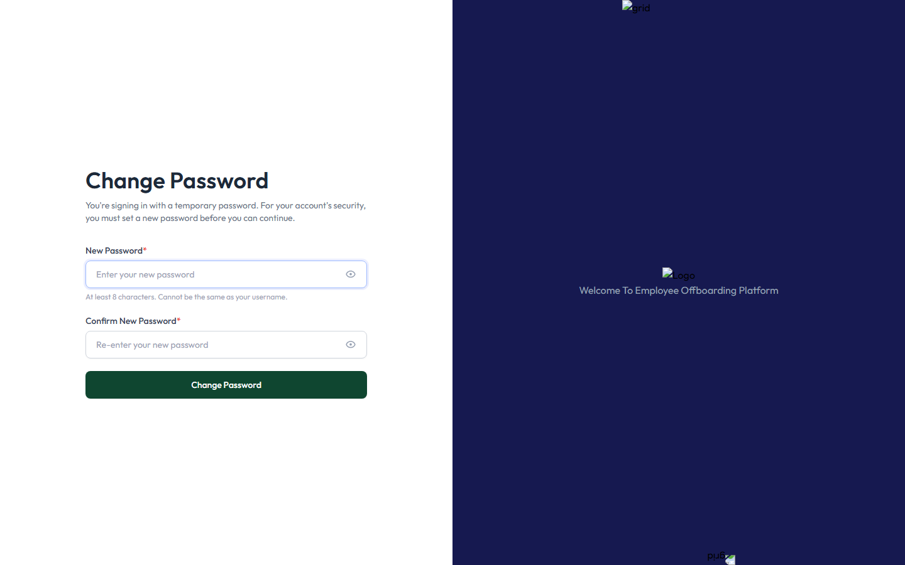
*Figure 2 — The forced password-change screen shown the first time you sign in with a temporary password.*

You must enter a **New Password** and **Confirm New Password** (minimum 8 characters, and it cannot be the same as your username) and click **Change Password**. Once this succeeds you're signed in normally and taken to the Approval page. You will not be asked to change your password again on future sign-ins — only the very first time, or any time an administrator issues you a new temporary password.

### Signing out

To sign out, click your name in the top-right corner of any page and choose **Sign out** from the dropdown. Always sign out when you're finished, especially on a shared computer, since your account can approve checklists and carries your electronic signature.

---

## User Profile and Electronic Signature

### Opening your profile

Click **User Profile** in the left menu at any time to open your profile page. It shows your photo/initials, name, position, and department at the top, followed by four sections: **Employment Information** (read-only — "Employment information is managed by HR and cannot be edited here"), **Personal Information** (editable via its own **Edit** button — full name, email, mobile number, current position/department), **Address**, and **Electronic Signature**.

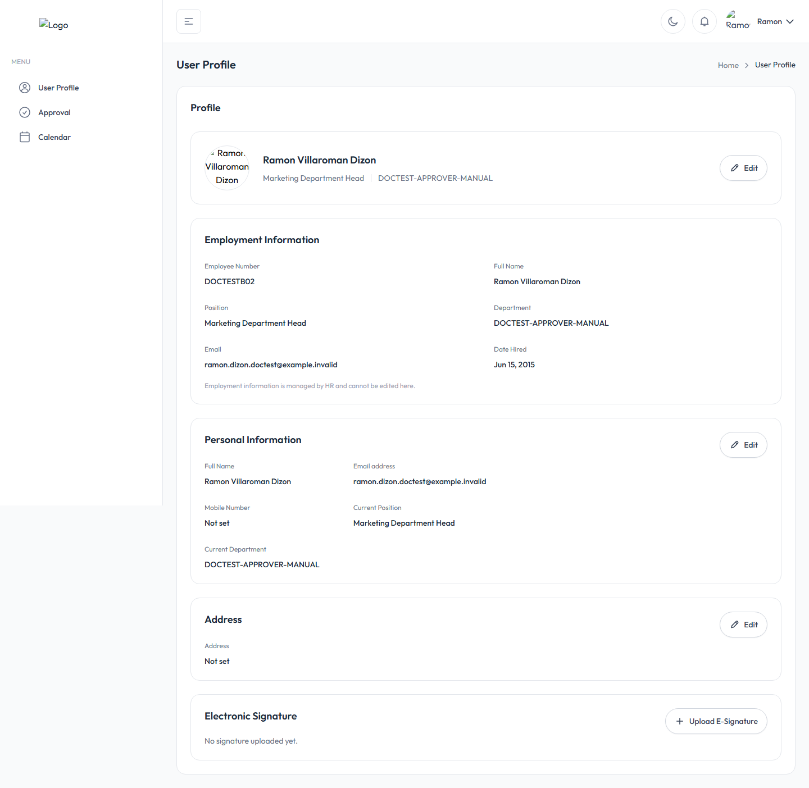
*Figure 3 — The User Profile page. The Electronic Signature card at the bottom reads "No signature uploaded yet."*

### Why your electronic signature matters

**Before your signature is uploaded, you cannot give final approval on anything** — not a checklist, not a General Signatory clearance, and not a Final Approval. This applies to whichever person is logged into the Approver account that is about to click Approve, regardless of which of the roles below applies to them on that particular request:

- A **Clearance Signatory / Department Head** approving a checklist.
- A **General Signatory** approving their own clearance item.
- The **Final Approver**, on the one-time final sign-off that closes out a completed offboarding request.

This requirement only blocks the **Approve** action specifically — you can still view checklists, check off items, add remarks, place a checklist on hold, or decline it without a signature on file. Only the final "yes, I approve this" step requires one.

### Uploading your signature

On the **User Profile** page, click **Upload E-Signature** (it reads **Update Signature** instead if you already have one on file) in the Electronic Signature card. A modal opens:

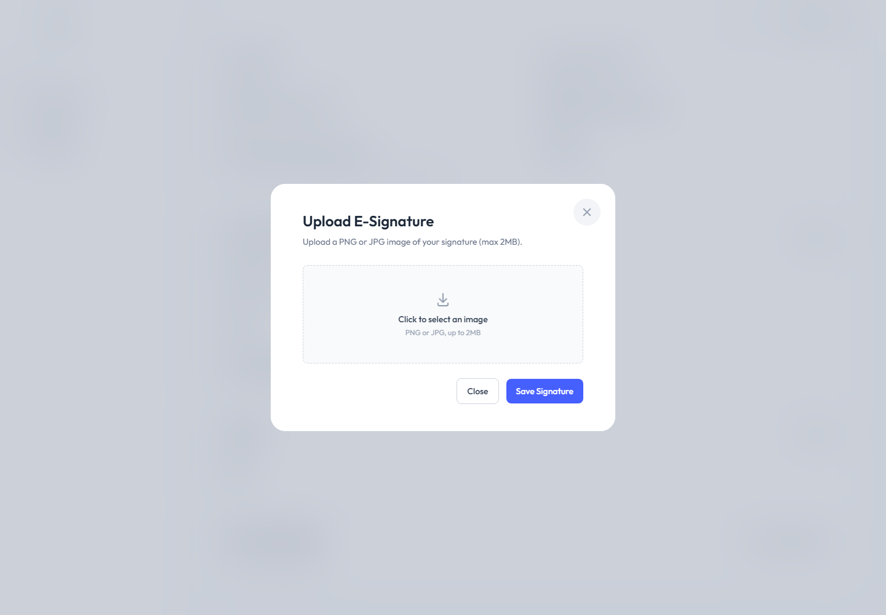
*Figure 4 — The Upload E-Signature modal.*

The modal states "Upload a PNG or JPG image of your signature (max 2MB)." Click the dashed box to select an image file from your computer.

> **Note on the file size limit:** the modal's own wording says "max 2MB," but the server actually enforces a slightly smaller limit of **1,900 KB** (roughly 1.86 MB). If your file is larger than 1,900 KB but still under 2MB, the upload will be rejected even though the on-screen text suggested it should be accepted. If this happens, compress or resize the image and try again.

Once you select a file, a preview appears with the filename and a **Choose a different file** link if you picked the wrong one:

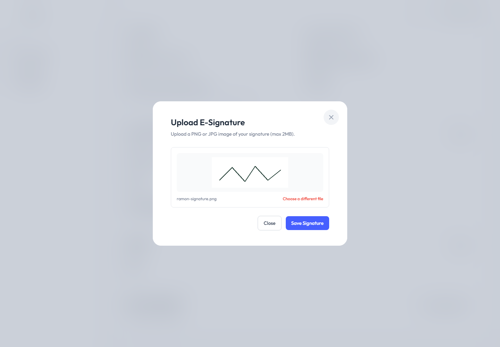
*Figure 5 — A signature image selected and previewed before saving.*

Click **Save Signature** to upload it. The Electronic Signature card on your profile then shows your signature image instead of "No signature uploaded yet.":

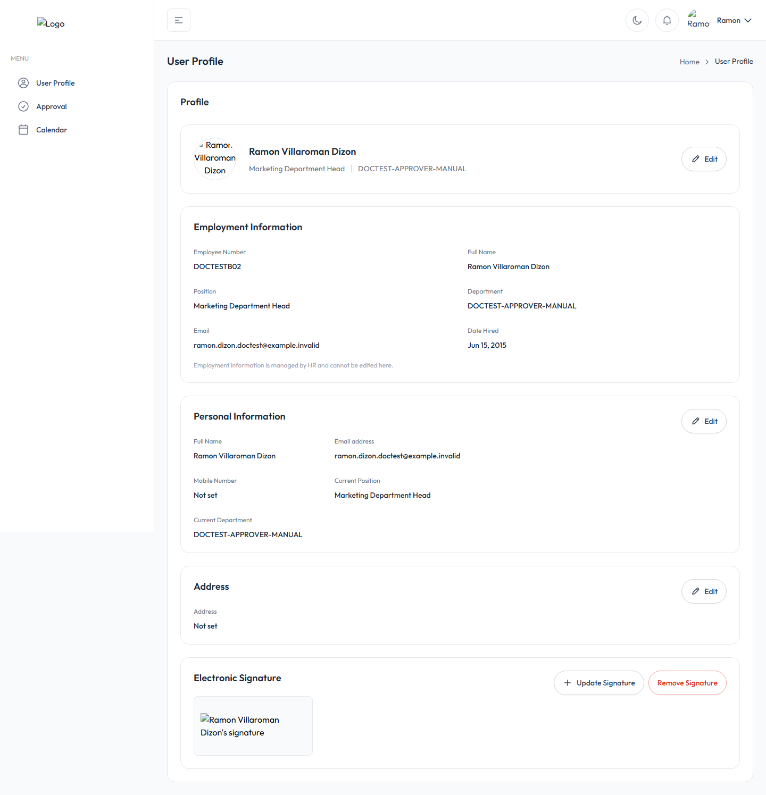
*Figure 6 — The Electronic Signature card once your signature has been saved.*

Only PNG, JPG, and JPEG image files are accepted. The same **Upload E-Signature** action is also how you **replace** an existing signature later — there is no separate "edit" step, you simply upload a new image over the old one.

---

## The Approval Module

Click **Approval** in the left menu to open **Your Approval** — the page where every checklist, task, and clearance item assigned to you is reviewed and acted on.

### 4.1 Viewing Assigned Offboarding Requests

The Approval page shows one card per offboarding employee you have something assigned to. Each card shows the employee's name, position, a status badge (**Pending**, **In Progress**, **On Hold**, **Overdue**, **Approved**, **Ready for Approval**, etc.), their department, separation reason, Last Working Day, and the relevant due dates.

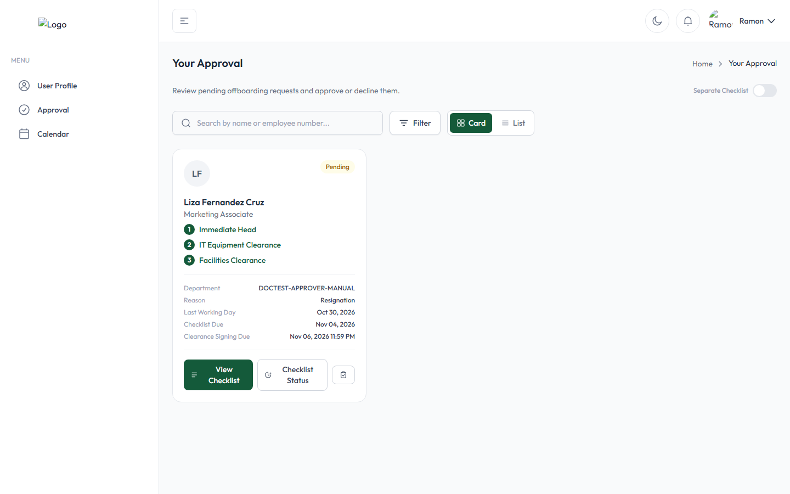
*Figure 7 — The Approval page. This employee has three checklists assigned to the same Approver, shown together on one card (numbered ①②③) because "Combine Checklist" display mode is on.*

By default, if more than one checklist on the same offboarding request is assigned to you, they're **combined onto a single card** (numbered badges, one per checklist). You can switch this with the **Separate Checklist** toggle in the top-right corner — turning it on splits them into one card per checklist instead:

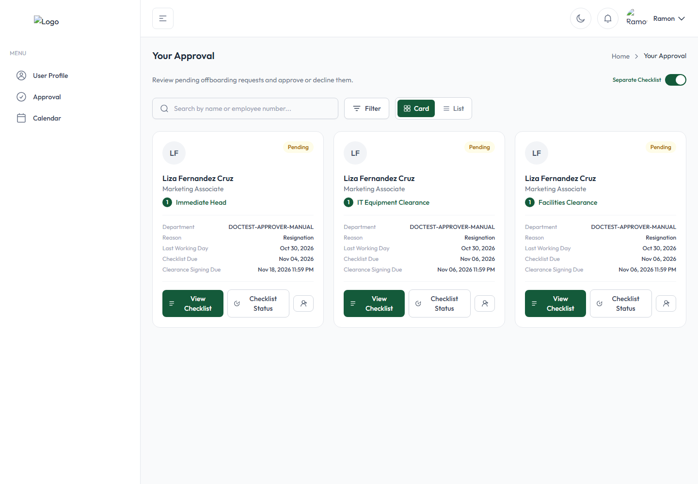
*Figure 8 — The same offboarding request with "Separate Checklist" turned on: one card per checklist instead of one combined card.*

This is purely a display preference saved to your own account — it never changes which checklists are assigned to you or how approval actually works, only how they're grouped on this page.

**Finding a specific request.** Use the **Search** box to filter by employee name or employee number, or click **Filter** to narrow by:

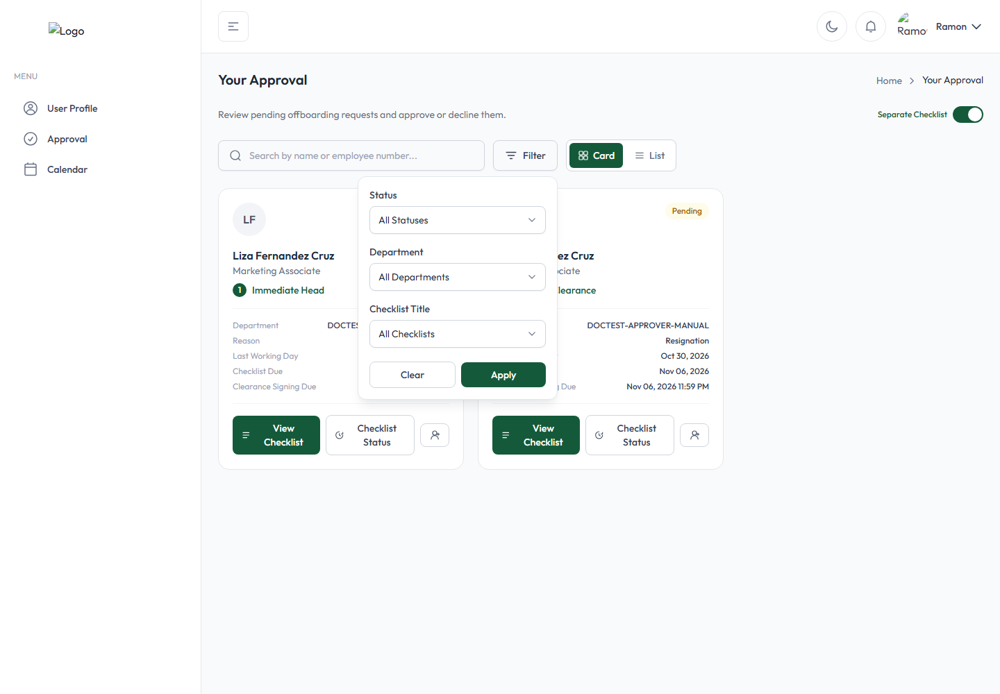
*Figure 9 — The Filter panel: Status, Department, and Checklist Title.*

- **Status** — All Statuses, Pending, In Progress, Completed, or Due.
- **Department**
- **Checklist Title**

**Identifying pending, overdue, and completed work.** The colored badge in the top-right of each card tells you the current state at a glance: amber **Pending**, blue **In Progress**, orange **Overdue**, amber **On Hold**, green **Approved**, or green **Ready for Approval**. Once a checklist is fully approved, its card stops appearing in the default (unfiltered) list — approved work doesn't clutter your active queue. To look up something you already approved, use the **Checklist Status** button described below, which keeps a full history regardless of current status.

**Opening a request.** Click **View Checklist** on any card to open and act on that checklist (see 4.2 onward). Click **Checklist Status** (the button instead reads **View Checklist Status** if you're a Task Assignee rather than the checklist's own primary approver) to see the Offboarding Status/Timeline for that request without opening the checklist itself — useful to confirm something was approved, see when it was viewed, or review the full history.

### 4.2 Viewing Checklists and Task Lists

There is no separate "task list" screen from the checklist screen — they are the same screen. The application calls the same set of items a **"checklist"** when you're its owning Clearance Signatory, and informally a **"task list"** (button labels like **"Process Task List"**) when you're a Task Assignee working on items someone else's checklist contains. The underlying items are identical either way.

**Opening a checklist.** Click **View Checklist** on a card. If the card combines several checklists, a row of numbered tabs appears at the top so you can switch between them — a check mark appears on any tab you've already approved:

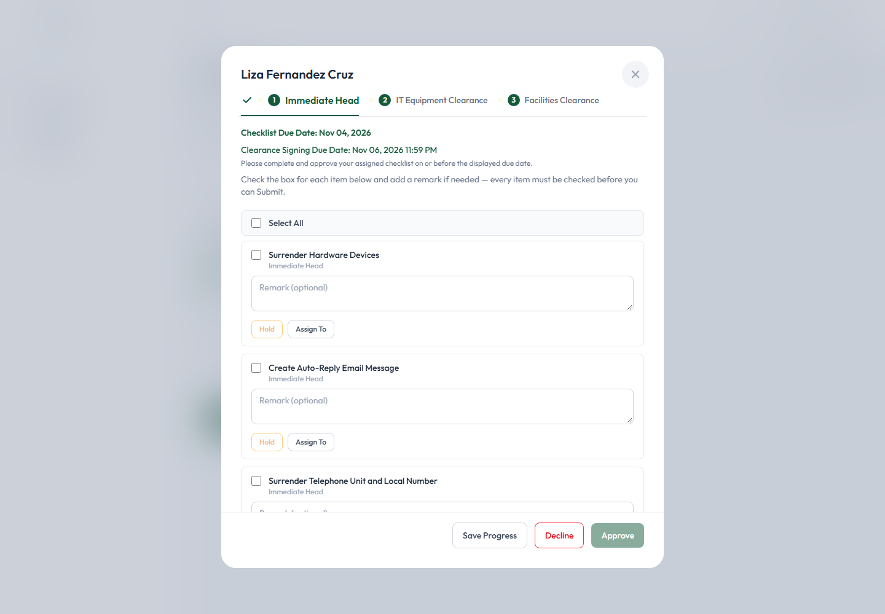
*Figure 10 — Switching between a card's several checklists using the numbered tabs at the top.*

Each checklist shows its **Checklist Due Date** and **Clearance Signing Due Date**, followed by every item with a checkbox, an optional **Remark** box, and (as the checklist's primary approver) **Hold** and **Assign To** buttons per item. A **Select All** control is available to check every item at once:

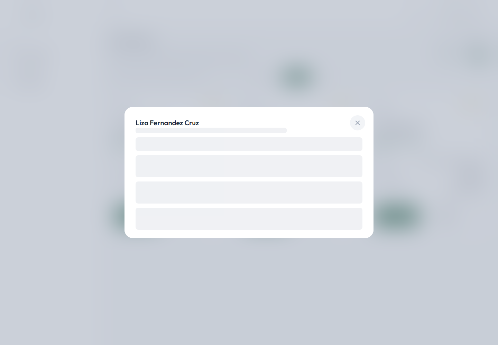
*Figure 11 — A checklist, not yet started: every item unchecked, Select All at the top.*

Checking items and typing remarks:

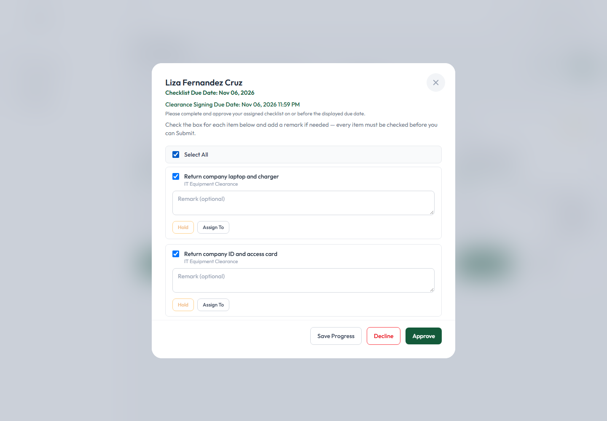
*Figure 12 — Every item checked via Select All, ready to Save Progress or Approve.*

**Reviewing progress at any point.** You don't have to finish in one sitting — click **Save Progress** at the bottom to save your checked items and remarks without submitting the checklist for approval. Come back later to finish.

**Identifying overdue and on-hold items.** A checklist that's past its due date shows an **Overdue** badge on its card; its Approve action also then requires you to type a remark explaining the delay (see 4.7). A checklist currently declined shows a dedicated amber banner inside the modal itself (see 4.4).

### 4.3 Assigning Tasks to Other Task Assignees

**Who can do this:** only the checklist's own **Clearance Signatory / Department Head** (its primary approver), or an administrator. A Task Assignee who already has one item assigned to them cannot reassign it to someone else themselves — only the checklist's owner can.

As the checklist's primary approver, each item has its own **Assign To** button. Click it to open the **Assign Checklist Item** modal:

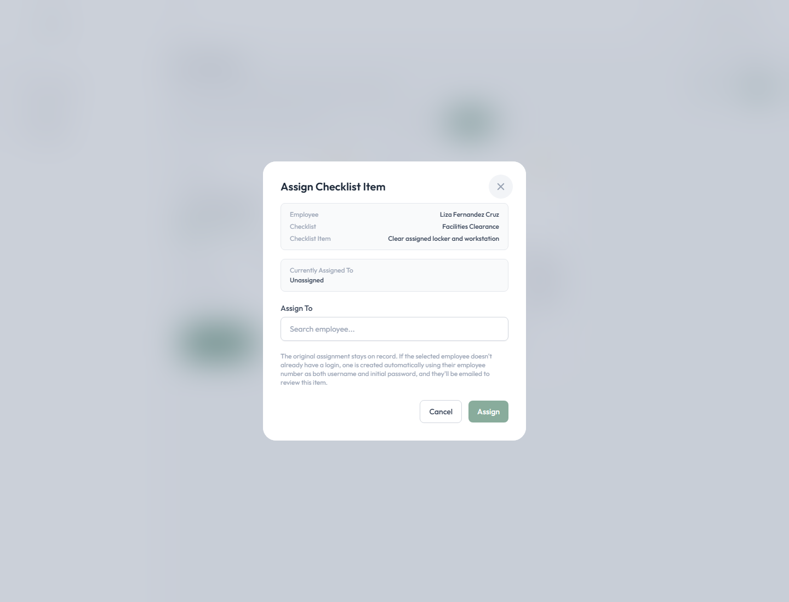
*Figure 13 — The Assign Checklist Item modal, showing the employee, checklist, item, and who (if anyone) currently has it.*

It shows the **Employee**, **Checklist**, and **Checklist Item** this concerns, who it's **Currently Assigned To** ("Unassigned" if no one yet), and an **Assign To** search box. Type a name or employee number to search — you can only pick someone eligible for this checklist (someone in the same Employee Master group, or flagged as a Task Assignee):

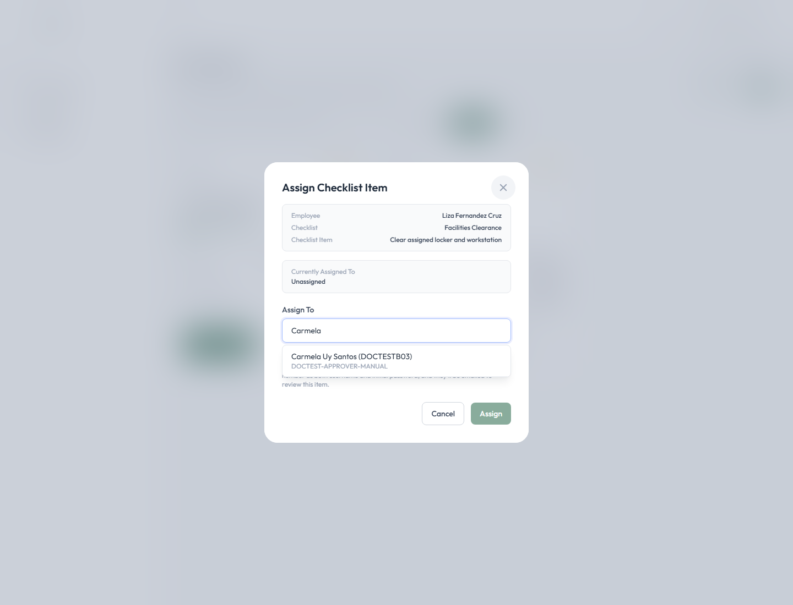
*Figure 14 — Searching for and selecting the new assignee.*

Select the employee, then click **Assign**. A confirmation dialog appears ("Reassign this checklist item?"); confirm to finish. The modal's own note explains what happens next: *"The original assignment stays on record. If the selected employee doesn't already have a login, one is created automatically using their employee number as both username and initial password, and they'll be emailed to review this item."*

**Verifying it worked.** Reopen the checklist — the item now shows **"Assigned To: [employee number] – [name]"** directly under its title:

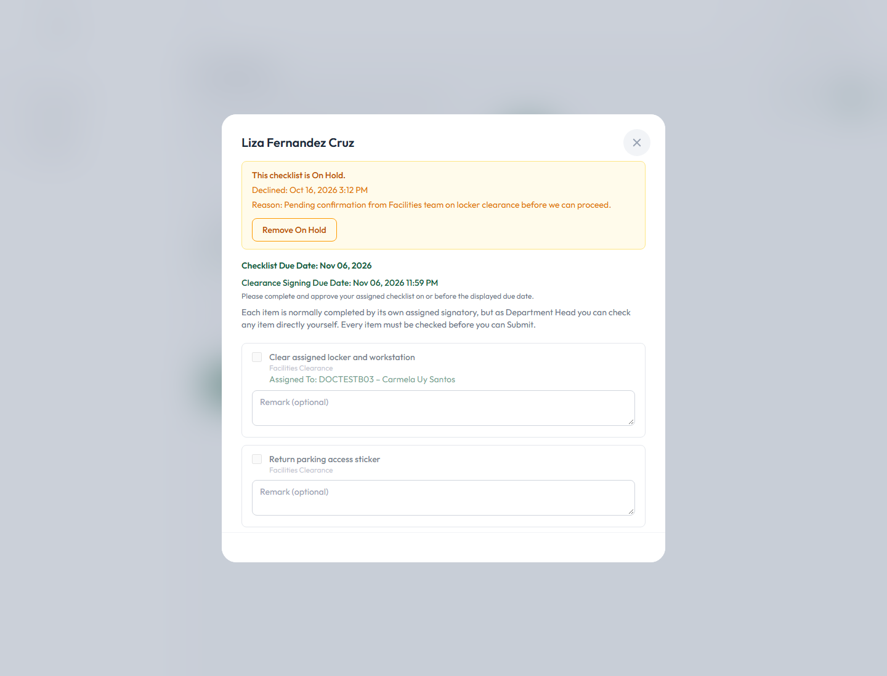
*Figure 15 — An item showing its new assignee ("Assigned To: DOCTESTB03 – Carmela Uy Santos") once reassignment is saved.*

**Notifications.** The newly assigned person is emailed about the item (and given login credentials automatically if they didn't already have an account). Reassigning the item never removes it from the checklist or changes who the checklist's overall Clearance Signatory is — it only changes who is expected to complete that one item; the Clearance Signatory can still check and complete any item themselves regardless of who it's assigned to.

### 4.4 Holding a Checklist

**When to use it:** place a whole checklist on hold when you genuinely cannot proceed yet — for example, you're waiting on confirmation from another team, or something on the checklist needs to be clarified before you can honestly check it off. In this application, placing a checklist on hold and **declining** it are the same action — there is one button, **Decline**, and it always results in an **On Hold** status; there is no separate "Hold" button at the whole-checklist level. (A **per-item** Hold also exists — see the note at the end of this section.)

See [4.6 Declining a Checklist](#46-declining-a-checklist) for the exact steps, since Decline is how a checklist is placed on hold.

**Per-item Hold**, by contrast, is a separate, smaller action: on an individual item, the **Hold** button next to it lets whoever is working that item (the checklist's primary approver, or the item's own assigned signatory) pause just that one item with a required remark, without affecting the rest of the checklist. The other items on the same checklist continue to be worked independently.

### 4.5 Removing an On-Hold Status

**When and how:** once a checklist has been declined (placed on hold), an amber banner appears at the top of its modal:

*Figure 16 — The On Hold banner: who declined it, when, the reason given, and the Remove On Hold button.*

The banner states **"This checklist is On Hold,"** the date it was declined, and the reason given. Click **Remove On Hold** to resume work. A confirmation dialog appears:

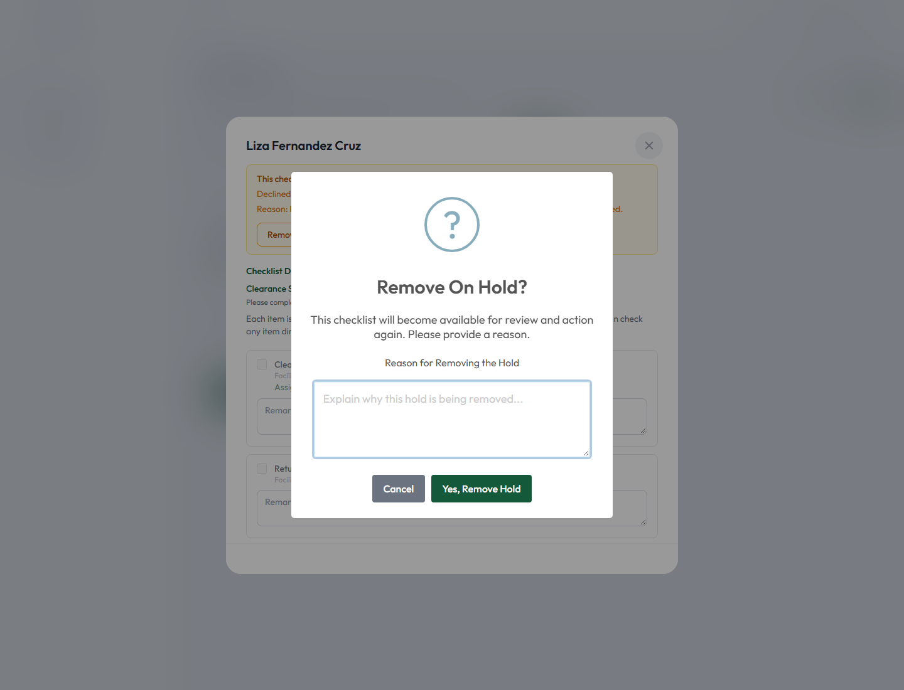
*Figure 17 — The Remove On Hold confirmation dialog, asking for a reason.*

It explains: *"This checklist will become available for review and action again. Please provide a reason."* Type your reason in the **Reason for Removing the Hold** box:

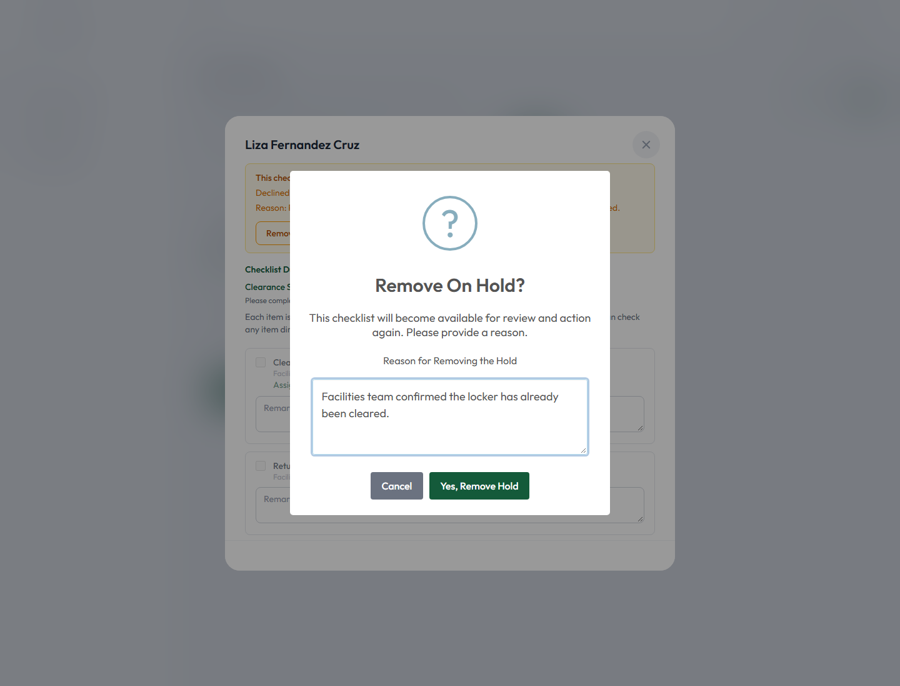
*Figure 18 — A reason entered before confirming.*

Click **Yes, Remove Hold** to confirm. The checklist returns to its normal, actionable state (its status reverts to **Pending**/in-progress — there is no separate "Resumed" status; it is simply treated as an ordinary active checklist again, now carrying both the original decline reason and this remove-hold reason on its history):

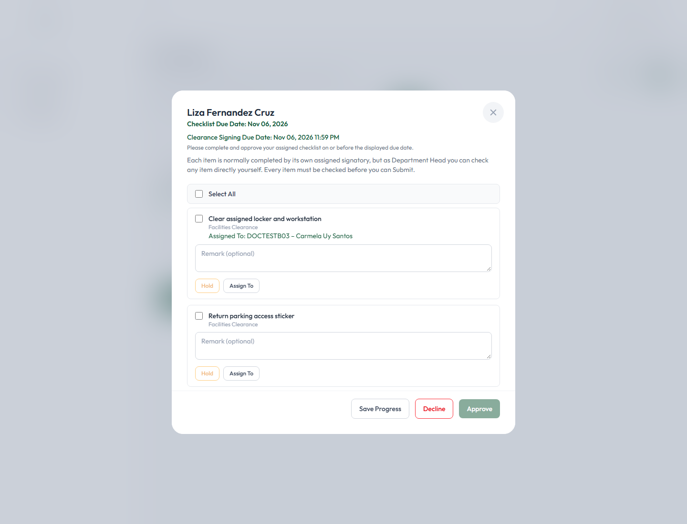
*Figure 19 — The checklist, no longer on hold, with its items available to check and submit again.*

**Who can do this:** the checklist's own Clearance Signatory, a delegate, or an administrator — the same people authorized to approve or decline it in the first place.

**Use the application's own wording:** the application always calls this action **"Remove On Hold"** (the button label, the confirmation dialog title, and the activity log entry all use this exact phrase) — it is never called "Resume" anywhere in the interface, so use that same term when communicating with colleagues about it.

### 4.6 Declining a Checklist

**When to decline:** use Decline when the checklist genuinely cannot move forward right now and you need to record why — the same action that places it on hold (see 4.4).

Click **Decline** at the bottom of the checklist modal. A confirmation dialog appears asking for a reason:

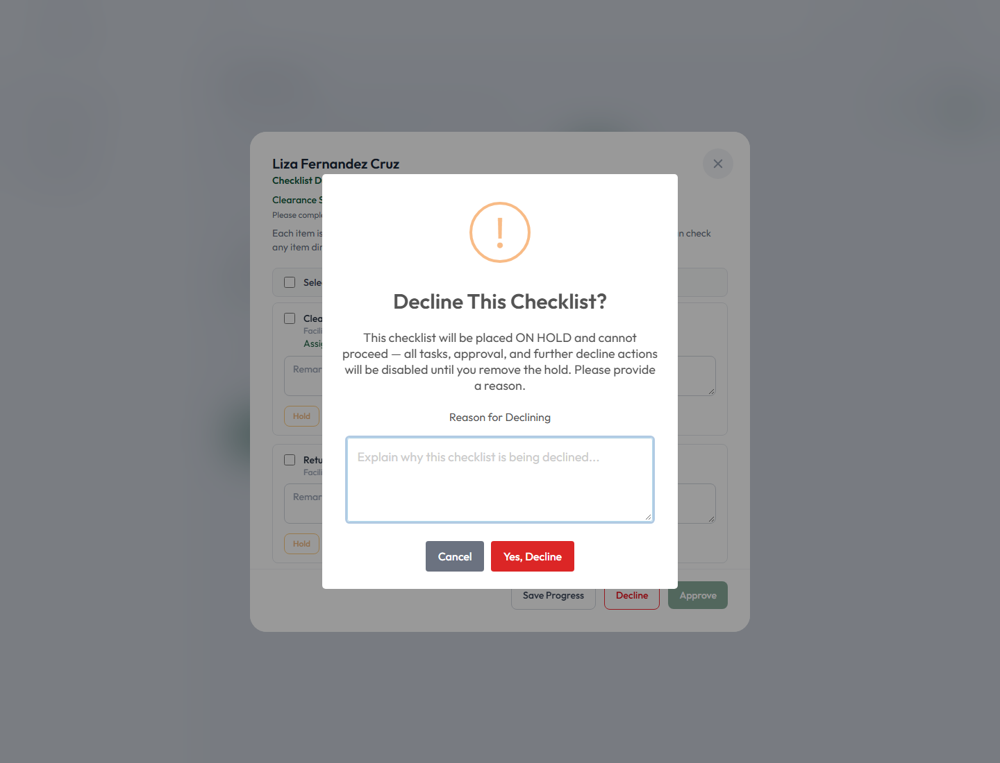
*Figure 20 — The "Decline This Checklist?" confirmation dialog.*

**A reason is required** — type it into the textarea (up to 2,000 characters):

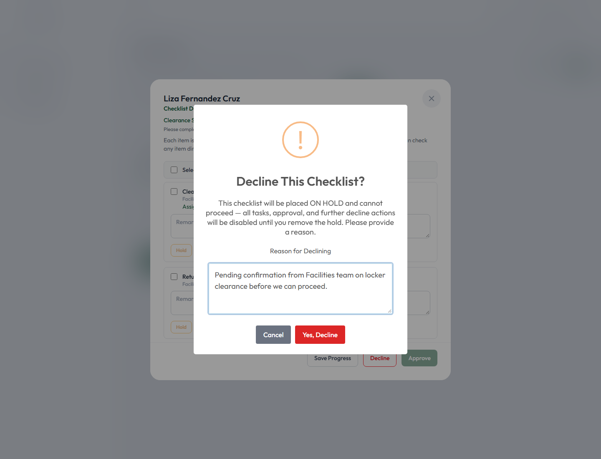
*Figure 21 — A decline reason entered before confirming.*

Click **Yes, Decline** to confirm. No electronic signature is required to decline — only to approve.

**What happens after:** the checklist's status becomes **On Hold** (see the banner shown in 4.5), and the request's creator (typically an Admin/HR) is notified by email that the checklist was declined, along with the reason given.

**Can a declined checklist later be approved?** Yes — this is the normal, expected path. Once whatever was blocking it is resolved, use **Remove On Hold** (4.5) to make it actionable again, then complete and Approve it as usual (4.7). Declining a checklist is not a dead end; it is a pause.

**Decline vs. Hold, in plain terms:**

| | **Decline** (whole checklist) | **Hold** (one item) |
|---|---|---|
| Scope | The entire checklist | A single item only |
| Effect | Checklist status becomes On Hold; rest of the request is unaffected | Only that item is paused; the checklist itself stays active |
| Reason required | Yes | Yes |
| Who can do it | Primary approver / delegate / admin | Primary approver, or the item's own assigned signatory |

### 4.7 Approving a Checklist

**Conditions that must be met first:**

1. **Every item must be checked.** The Approve button has no effect until all items on the checklist are checked off.
2. **A remark is required if the checklist is overdue** (past its due date) — otherwise a remark is optional.
3. **Your electronic signature must be on file** (see the User Profile section above) — without one, Approve is blocked outright.

**Attempting to approve without a signature.** If you click Approve before uploading a signature, the checklist does not approve — instead you are redirected straight to your **User Profile** page, with the Electronic Signature card right there ready for you to use:

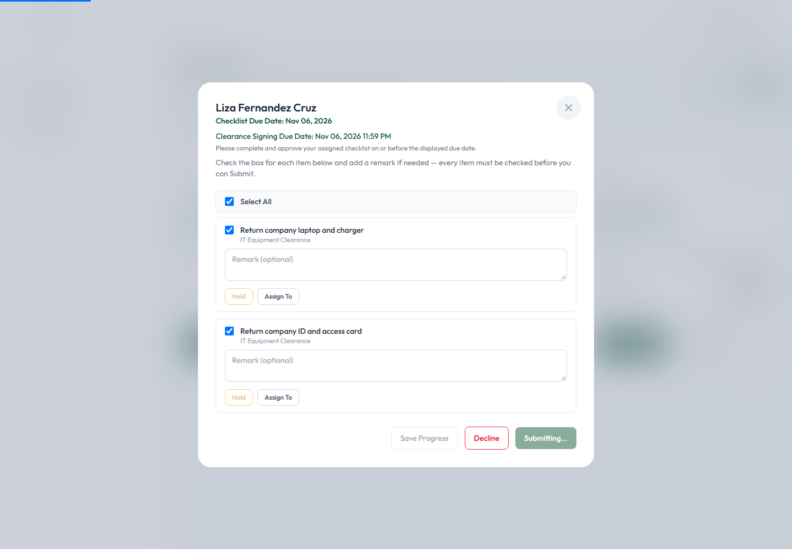
*Figure 22 — The Profile page you land on if you try to Approve before your signature is on file.*

Upload your signature (4. User Profile and Electronic Signature, above), then return to Approval and open the checklist again.

**Approving.** With every item checked and a signature on file, click **Approve** at the bottom of the modal. If the checklist is overdue, you'll be asked for a remark first; otherwise it submits immediately.

**What happens after approval:**

- The checklist's status becomes **Approved**, and it drops out of your default (unfiltered) Approval queue.
- You're returned to the Approval page with a confirmation banner and toast:

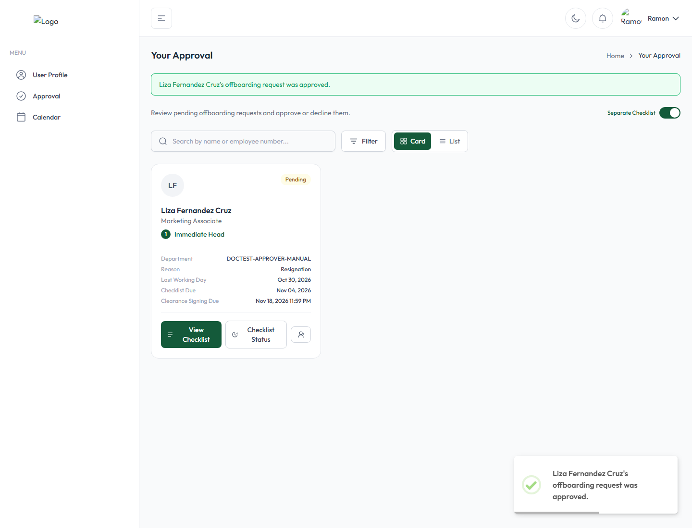
*Figure 23 — "Liza Fernandez Cruz's offboarding request was approved." confirmation after clicking Approve.*

- Depending on what else is still pending on the same offboarding request, this may trigger the next stage automatically (e.g. attaching a Final Pay checklist once every regular checklist and General Signatory clearance is approved).

**Verifying it was approved.** Open **Checklist Status** on that employee's card at any time afterward — the timeline shows a **"Cleared by [your name] ... Reason: Approved checklists: [checklist title]"** entry with the exact date and time:

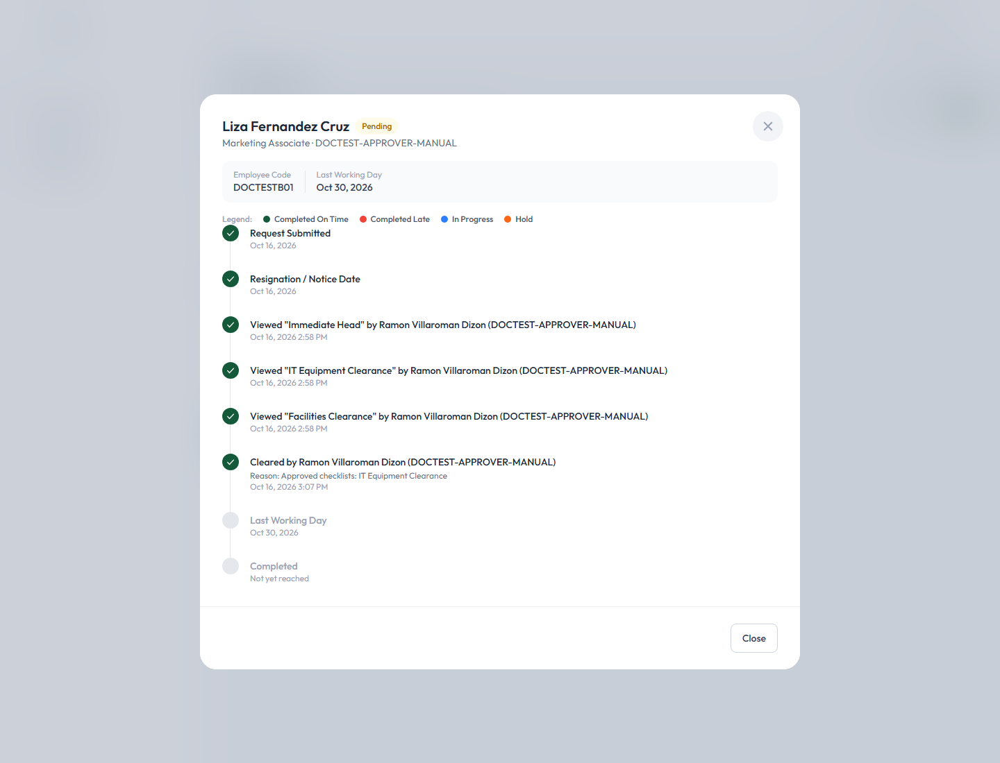
*Figure 24 — The Offboarding Status/Timeline modal, confirming "Cleared by Ramon Villaroman Dizon ... Reason: Approved checklists: IT Equipment Clearance."*

**Multiple checklists or approval tabs on the same card.** If several checklists for the same employee are combined onto one card, work through each tab in turn (see Figure 10) — approving one tab does not automatically approve the others; each is reviewed and approved independently, and a check mark appears on a tab's own icon once it's been approved. Switching tabs does not lose your progress on the other tabs.

**A Task Assignee's own item-level view.** If you're a Task Assignee rather than the checklist's primary approver, your Approval card is scoped to just what's assigned to you, and shows **"Assigned by: [the Department Head's name]"**:

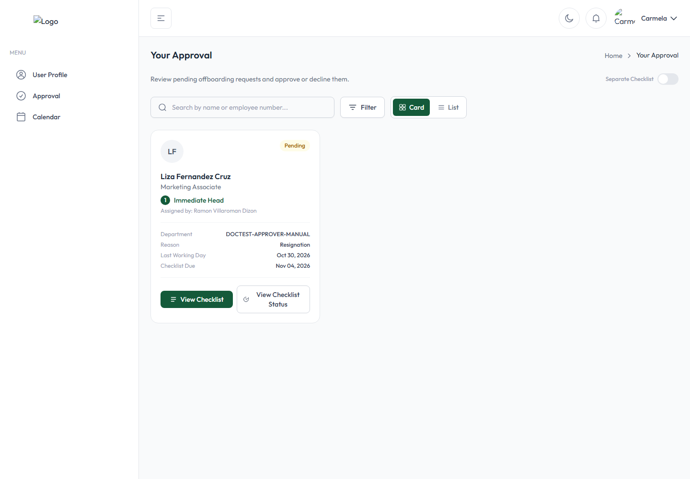
*Figure 25 — A Task Assignee's Approval page: only the one checklist that has an item assigned to them.*

Opening it shows your own assigned item with **Hold** and **Submit** buttons, while any other, not-yet-claimed item on the same checklist shows a **Process Task List** button instead — a voluntary way to take over an unassigned item yourself:

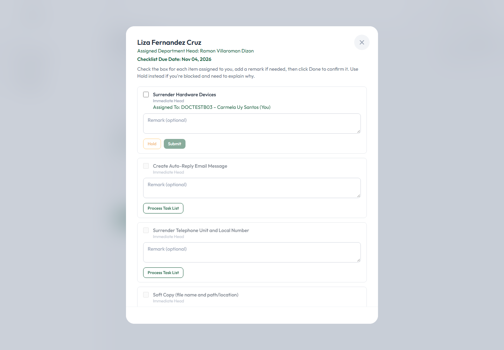
*Figure 26 — "Assigned To: ... (You)" on your own item (Hold/Submit), vs. "Process Task List" on items not yet assigned to anyone.*

Check the box, add a remark if useful, and click **Submit** to mark your item complete:

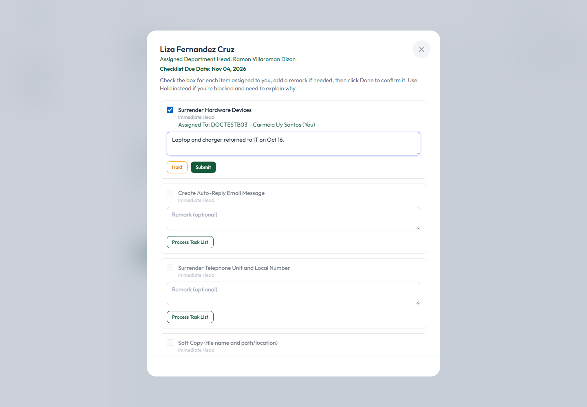
*Figure 27 — A Task Assignee's own item, checked and remarked, ready to Submit.*

This does **not** approve the whole checklist by itself — only the checklist's Clearance Signatory can do that, once every item (including yours) is checked. From the Clearance Signatory's own view, your completed item now shows who checked it and when:

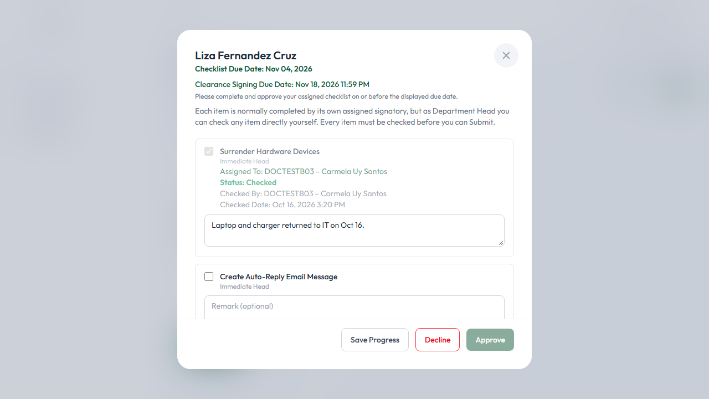
*Figure 28 — "Status: Checked / Checked By: Carmela Uy Santos / Checked Date: ..." as seen by the checklist's own Clearance Signatory.*

**General Signatory approval is a related but separate workflow**, covered next.

#### A note on General Signatory clearance

Some offboarding requests also carry a **General Signatory** clearance — a separate, company-wide approval track that exists independently of any checklist. If you're assigned as a General Signatory, your Approval card shows a **Review & Approve** button instead of View Checklist:

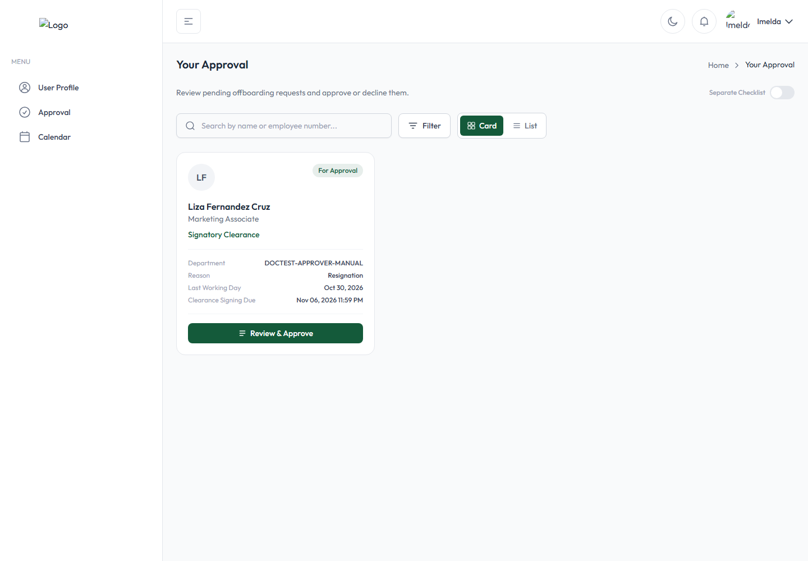
*Figure 29 — A General Signatory's card: "Review & Approve" instead of View Checklist.*

Clicking it opens a simpler modal — a summary of the employee's details and, if no specific task list has been configured for this signatory, a direct note to that effect:

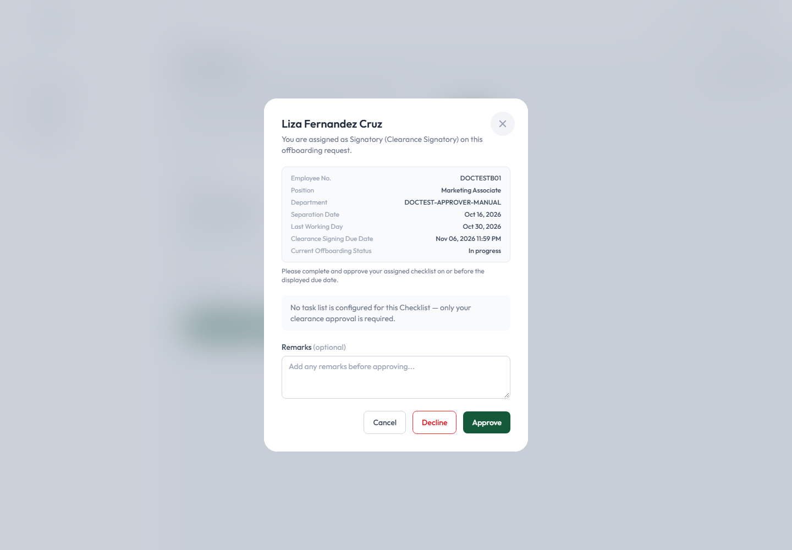
*Figure 30 — "You are assigned as Signatory (Clearance Signatory) on this offboarding request." The note here reads "No task list is configured for this Checklist — only your clearance approval is required."*

It has its own **Cancel**, **Decline**, and **Approve** buttons, working the same way as an ordinary checklist's (Decline requires a reason and places it on hold; Approve requires your signature to be on file). Add an optional remark and click **Approve** to give your clearance.

---

## 5. Approving Checklists Through Email

Clearance Signatories, General Signatories, and the Final Approver can also approve their assigned checklist (or clearance item) by clicking a link in an email — **without needing to sign in first.**

**Which emails contain this link.** Once every item on a checklist you own has been checked (by you or by the Task Assignees working under you), you're emailed a notification:

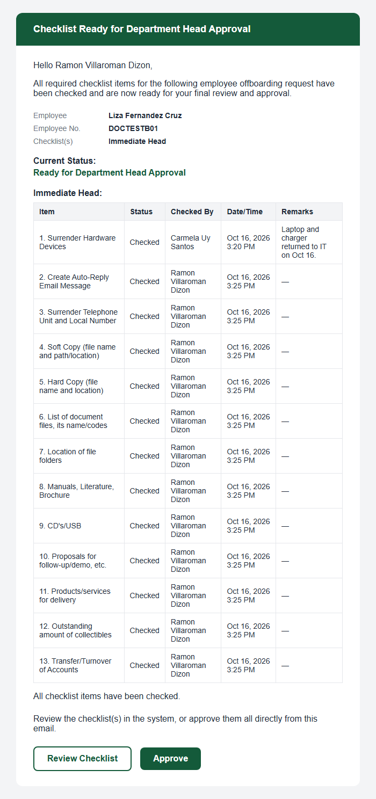
*Figure 31 — The email sent once every item on your checklist has been checked, with a full breakdown of who checked what and when.*

It lists every item, who checked it, when, and any remark, and ends with two buttons: **Review Checklist** (opens the normal, in-app Approval page — this does require signing in) and **Approve** (the one-click, no-login link). The same kind of email-based Approve link is also sent to General Signatories and to the Final Approver for their own respective clearance steps.

**Important:** the emailed link only ever offers **Approve**. There is no emailed Decline or Hold link — if you need to decline or hold a checklist, you must sign in and use the in-app Approval page (sections 4.4–4.6) instead.

**Using the link.** Click **Approve** in the email. No login is required — you're taken straight to a confirmation screen summarizing exactly what you're about to approve:

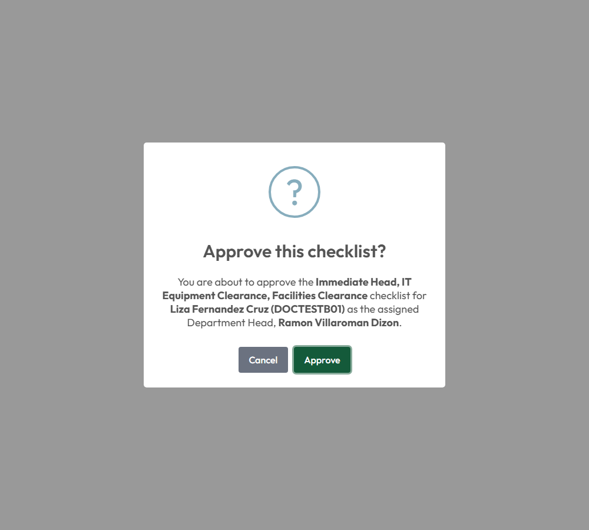
*Figure 32 — "Approve this checklist?" — the confirmation shown after clicking the Approve link in the email, before anything is actually submitted.*

It states exactly which checklist(s), for which employee, and as which Department Head you're approving — review this carefully, since no further detail is shown on this screen. Click **Approve** to confirm, or **Cancel** to back out without approving anything.

**The result.** On success, you see an immediate confirmation:

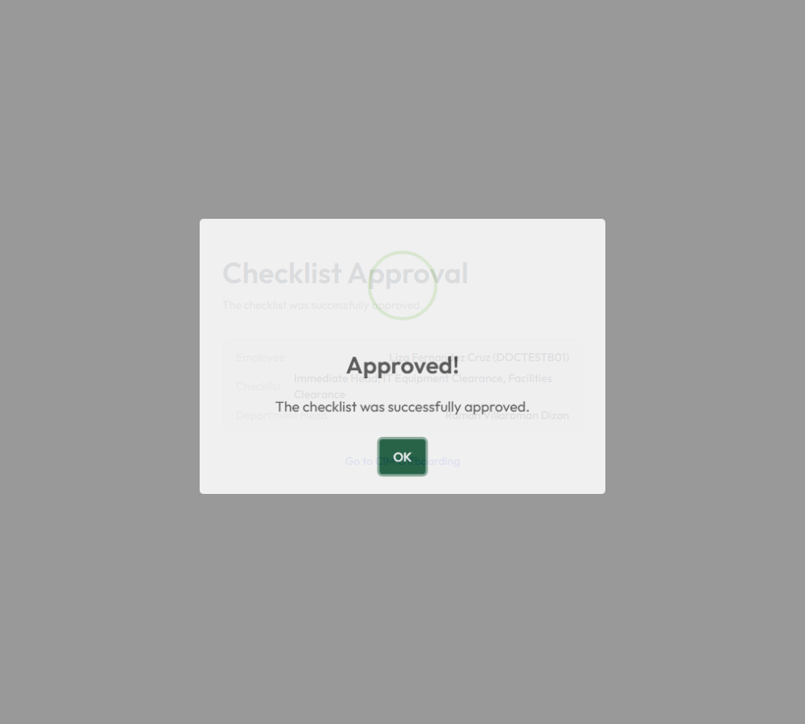
*Figure 33 — "Approved! The checklist was successfully approved." — shown immediately after confirming, still with no login required.*

**If the link doesn't work.** Each link is generated specifically for one checklist and expires after a number of days. If you see an error instead of the confirmation screen, it's one of:

- **The link is invalid or has expired** — sign in to the application normally and use the Approval page instead.
- **Already approved** — someone (possibly you, earlier) already approved it through this same link or in the app; nothing further is needed.
- **Not ready yet** — not every item has been checked yet; check the remaining items in the app first.
- **A remark is required** — this happens if the checklist has since become overdue; the one-click email link has no field to collect that remark, so you're directed to sign in and use the app instead.
- **No signature on file** — you're redirected to upload your electronic signature before you can approve, exactly as described in section 4.7.

**Verifying the result.** Whether you approved in-app or through the email link, check the same way: open **Checklist Status** on that employee's card, or look for the "Cleared by ..." entry on the timeline (Figure 24).

---

## 6. Calendar Module

Click **Calendar** in the left menu to see a month/week/day calendar of offboarding-related dates:

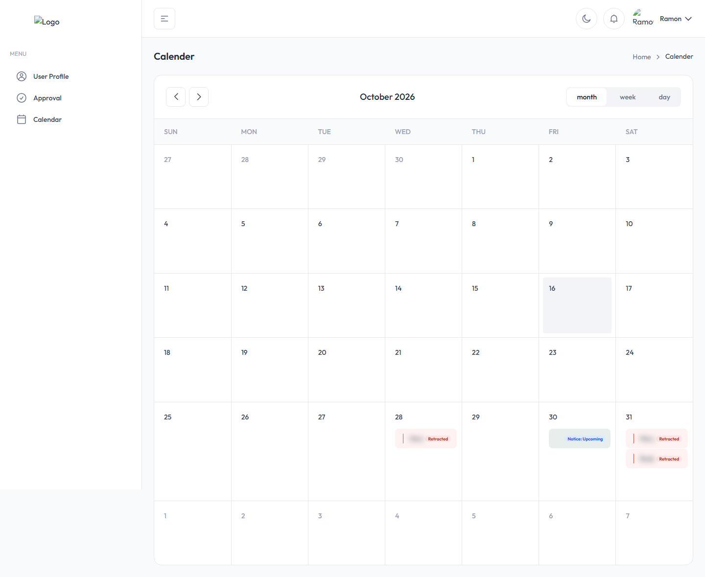
*Figure 34 — The Calendar page, showing Last Working Day events for every offboarding employee company-wide.*

Use the **◀** / **▶** arrows to move between months (or weeks/days, using the **month / week / day** toggle in the top-right), and click **Today**'s highlighted date to jump back to the current day. Each colored badge on a date represents one offboarding employee's event for that day — for example a blue **"Notice: Upcoming"** badge or a red **"Retracted"** badge for a request that was later cancelled.

**Important — this calendar is company-wide, not scoped to your own assignments.** Unlike the Approval page, the Calendar shows every offboarding employee's Last Working Day across the entire company, not only the ones you're personally assigned to approve. There is no filter to narrow it down to just your own cases. Use it as a general awareness tool for upcoming offboarding activity, and cross-reference the Approval page (section 4.1) for exactly what's assigned to you.

The Calendar is read-only for an Approver — there is no way to create, edit, or drag an event from this page.

> **Note:** the page's own heading is spelled **"Calender"** in the application's interface (not "Calendar") — this is simply how the application labels it today, not a typo in this manual.

---

## 7. Best Practices for Approvers

- **Review carefully before acting.** Open every assigned checklist and read the employee's details and each item before checking anything off — approval should always follow genuine review, not a rubber stamp.
- **Complete or verify required items first.** Make sure every item genuinely reflects what has actually happened before you check it.
- **Write clear, accurate remarks** wherever a remark field is offered, especially on Decline and Remove On Hold — the next person to look at the history relies on what you wrote.
- **Use Decline/Hold when something is genuinely blocking you**, and reserve it for real blockers — not as a way to delay routine review.
- **Keep your electronic signature current.** If you're a Clearance Signatory, General Signatory, or the Final Approver, upload your signature as soon as your account is created so you're never blocked at the moment you need to approve something.
- **Monitor your Approval page regularly** for new Pending or Overdue items, rather than relying solely on email.
- **Read your email notifications**, especially the "Checklist Ready for Department Head Approval" emails — they let you approve in one click without needing to sign in.
- **Confirm the result after every action.** Use Checklist Status / the Offboarding Status timeline to verify a checklist genuinely shows as approved, on hold, or declined as you expect.
- **Reassign items only to people who should actually own them**, and never reassign the whole checklist away from yourself just to avoid reviewing it.
- **Protect your login credentials**, never share your username/password, and always sign out on a shared computer.

---

## 8. Glossary of Terms

| Term | Meaning |
|---|---|
| **Approver** | The account type used by anyone who reviews and acts on offboarding checklists or clearance items — covers Clearance Signatories, Task Assignees, and General Signatories alike. |
| **Offboarding Request** | The record created once an employee's separation is initiated — tracks their checklists, clearance items, and overall status until completion. |
| **Offboardee** | The employee who is being offboarded. |
| **Checklist** | A set of items that must be reviewed/checked and ultimately approved by its assigned Clearance Signatory. |
| **Task Assignee** | An employee flagged as eligible to be handed individual checklist items, distinct from the checklist's own Clearance Signatory. |
| **Clearance Signatory** | The person (usually a Department Head) who owns a checklist and gives its final Approve/Decline. Also called the checklist's primary approver. |
| **General Signatory** | A separate, company-wide clearance role, independent of any specific checklist — gives their own Approve/Decline on the offboarding request as a whole. |
| **Final Approver** | The single, admin-configured person who gives the very last sign-off on an offboarding request, after every checklist and General Signatory clearance is already approved. |
| **Pending** | A checklist or item not yet acted on. |
| **In Progress** | Some but not all items on a checklist have been checked. |
| **On Hold** | A checklist that has been declined and is awaiting its hold to be removed before it can proceed further. |
| **Declined** | The historical/legacy label for what is now always shown as On Hold once a checklist is declined — "Decline" and "On Hold" describe the same event. |
| **Approved** | The Clearance Signatory (or General Signatory) has given final sign-off on their own checklist or clearance item. |
| **Overdue** | A checklist that has passed its due date without being approved. |
| **Ready for Approval** | Every item on a checklist has been checked, and it is now waiting on the Clearance Signatory's final Approve. |
| **Last Working Day (LWD)** | The employee's final day of employment, as recorded on their offboarding request. |

---

*This manual was produced by directly testing the application's Approval module, User Profile, and Calendar using sample ("DOCTEST"-prefixed) employee and checklist data created and removed specifically for this purpose — no real employee's personal information, credentials, or private communications appear in any screenshot in this document.*
