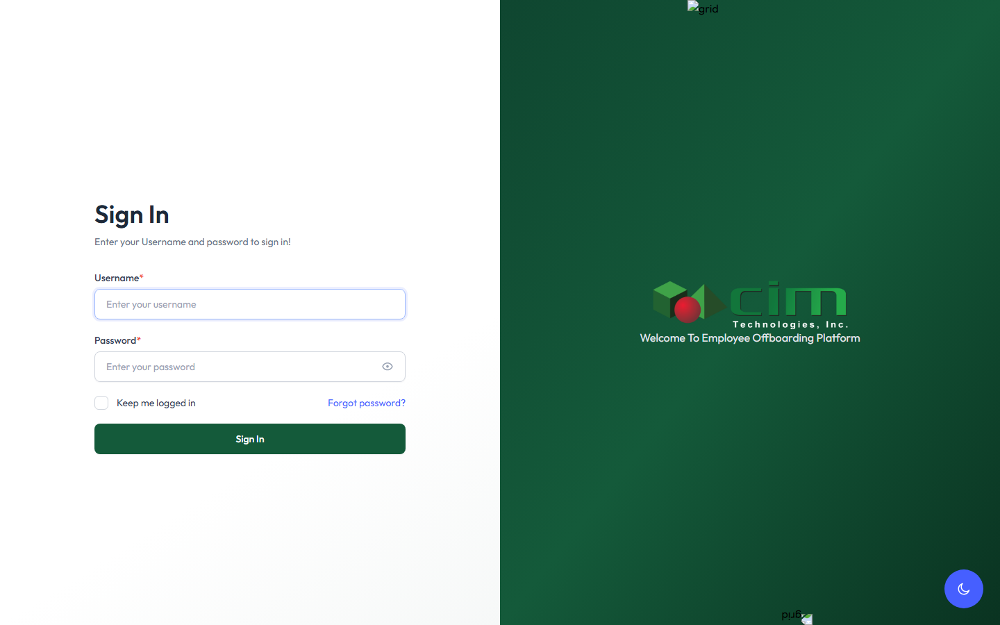
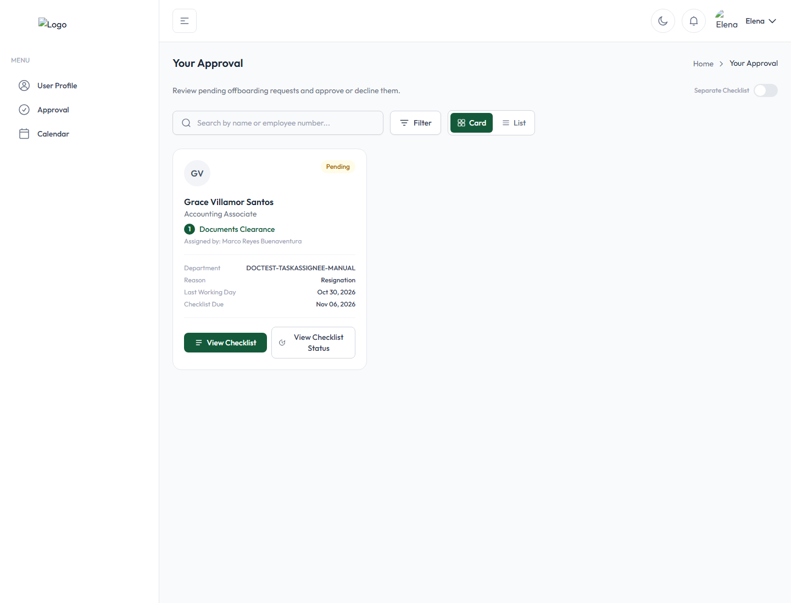
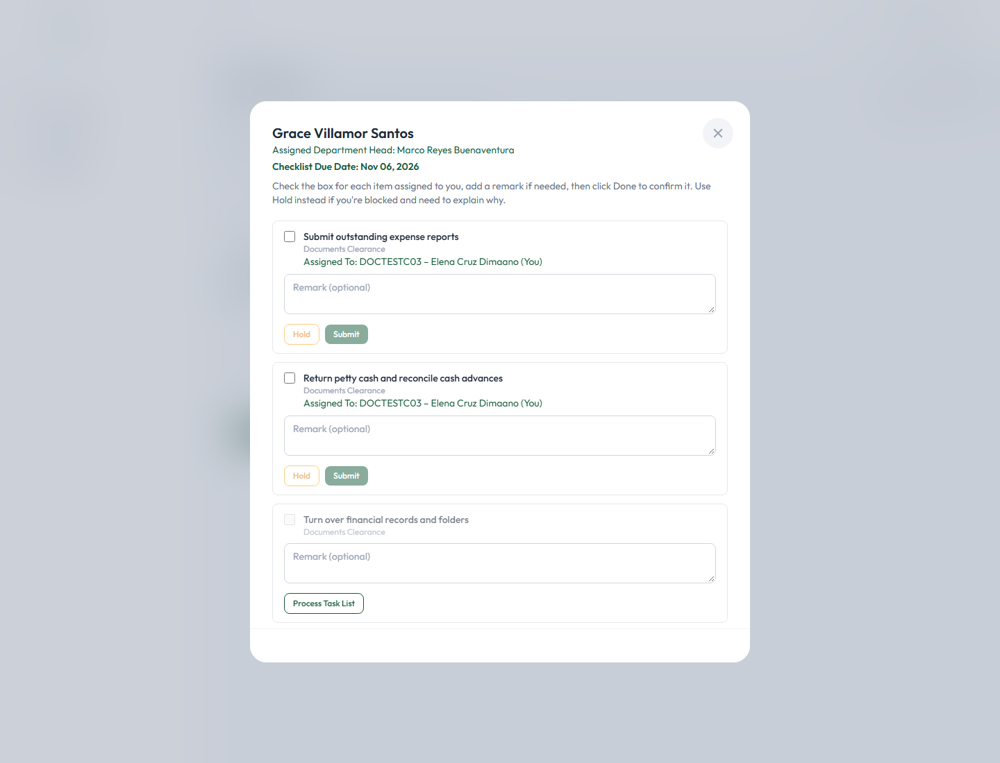
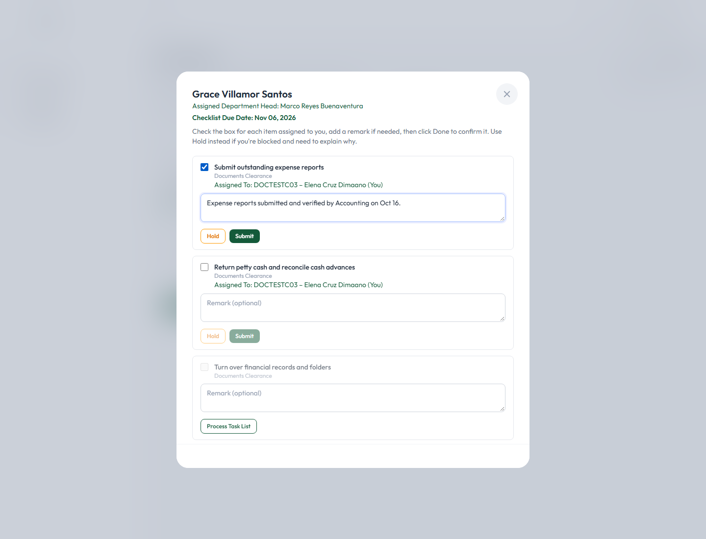
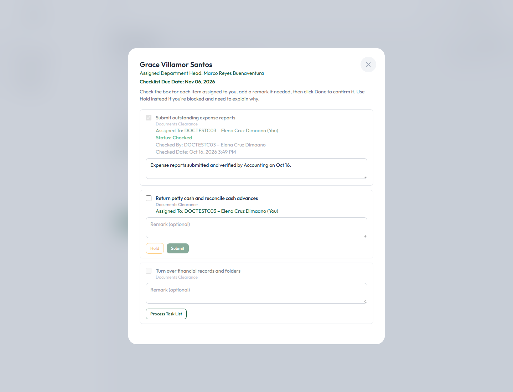
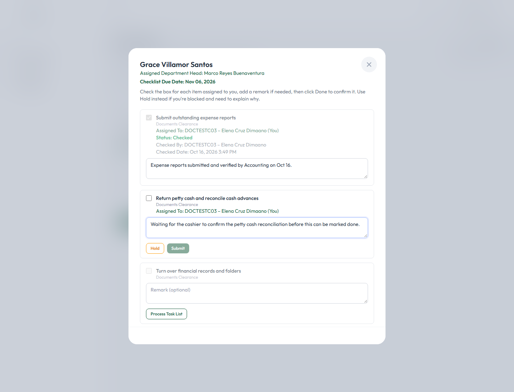
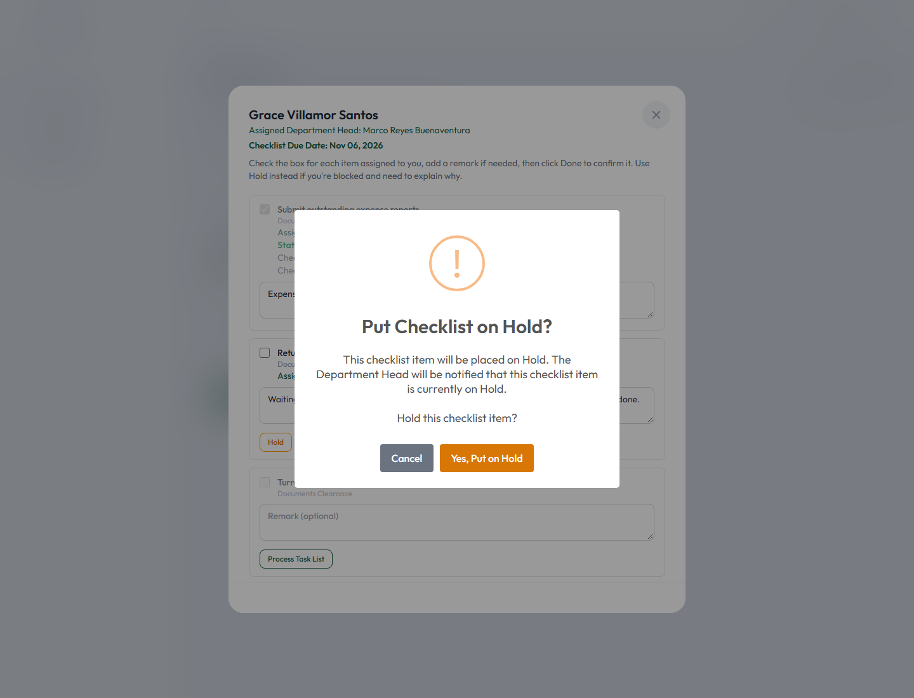
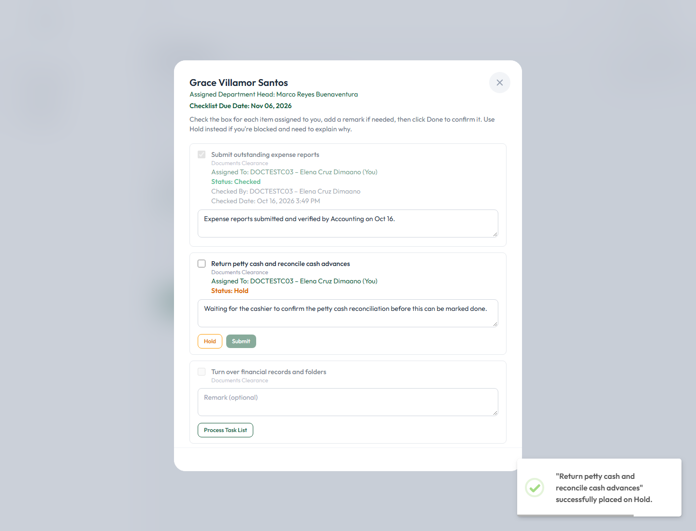

# CIM OffBoarding — Task Assignee User Manual

**Version:** 1.0 &nbsp;|&nbsp; **Revision date:** October 16, 2026

This manual is written for **Task Assignees** — employees handed one or more individual checklist tasks as part of a coworker's offboarding, without owning the whole checklist themselves. It was produced by directly testing the application end to end (every screenshot is a real, step-by-step walkthrough using disposable sample data) and by inspecting the underlying routes, controllers, and validation rules, so every instruction and status quoted here reflects what the application actually does today.

---

## Table of Contents

1. [Introduction](#introduction)
2. [Signing In](#signing-in)
3. [Accessing Assigned Checklist Tasks](#accessing-assigned-checklist-tasks)
4. [Checking or Completing a Task](#checking-or-completing-a-task)
5. [Clearing or Unchecking a Task](#clearing-or-unchecking-a-task)
6. [Placing a Task on Hold](#placing-a-task-on-hold)
7. [Monitoring Task Status and Deadlines](#monitoring-task-status-and-deadlines)
8. [Common Issues and Troubleshooting](#common-issues-and-troubleshooting)
9. [Best Practices](#best-practices)
10. [Glossary of Terms](#glossary-of-terms)

---

## Introduction

CIM OffBoarding is CIM Technologies' internal system for managing an employee's exit from the company, from the moment a resignation is recorded until every clearance requirement has been signed off. Each checklist used in that process is broken down into individual **tasks** (checklist items), and some of those tasks may be handed to you specifically — not to the checklist's overall owner — because the work genuinely belongs to you.

**Your role as a Task Assignee** is narrow and specific: you are responsible only for the individual task(s) assigned to you within someone else's checklist. You do not own the checklist itself, and you cannot approve, decline, or otherwise finalize it — only its Clearance Signatory (usually a Department Head) can do that, once every task on it, including yours, is done.

**Process only what is assigned to you.** Your account only ever shows checklists that have at least one task assigned to you — never a coworker's unrelated checklist, and never tasks that belong to someone else on the same checklist.

Your available actions are limited to exactly three things:

- **Check (complete) a task**, once its requirement has genuinely been fulfilled.
- **Place a task on hold**, if it can't be completed yet and you need to explain why.
- ~~Clear or uncheck a completed task~~ — **not available.** See [section 5](#clearing-or-unchecking-a-task) for exactly why, and what to do instead if you checked something by mistake.

You do **not** have access to checklist-level approval, declining a whole checklist, or approving an offboarding request — those are the Clearance Signatory's responsibilities, not a Task Assignee's. This manual does not document those actions because your account cannot perform them.

---

## Signing In

### Accessing the application

Open the application's web address in your browser to reach the **Sign In** page:

*Figure 1 — The Sign In page.*

Enter the **Username** and **Password** given to you, then click **Sign In**.

### First-time password change

The first time you ever sign in — typically right after a Department Head assigns you your first task, which auto-creates your account — your username and password are both your employee number, and the system treats that as a temporary password. You're taken straight to a **Change Password** screen before you can do anything else:

*Figure 2 — The forced password-change screen shown the first time you sign in with a temporary password.*

Enter a **New Password** and **Confirm New Password** (at least 8 characters, and it cannot be the same as your username), then click **Change Password**. You won't be asked again on later sign-ins — only the very first time, or if an administrator later issues you a new temporary password.

### Signing out

Click your name in the top-right corner of any page and choose **Sign out**. Always sign out when finished, especially on a shared computer.

---

## Accessing Assigned Checklist Tasks

### Finding your tasks

Click **Approval** in the left menu. This page, **Your Approval**, shows one card per offboarding employee you have at least one task assigned to. Unlike a Clearance Signatory's view, your card is scoped strictly to the checklist(s) that actually have something assigned to you, and shows **"Assigned by: [the Clearance Signatory's name]"** directly under the checklist title:

*Figure 3 — The Approval page as seen by a Task Assignee: one card, showing only the checklist that has a task assigned to them, and who assigned it.*

The card shows the offboarding employee's name and position, a status badge (**Pending**, **In Progress**, **On Hold**, **Overdue**, etc.), their department, separation reason, and the relevant due dates. Click **View Checklist** to open it.

### Identifying the employee and the checklist

The employee's name appears at the top of the card and again at the top of the checklist itself once opened, along with the checklist's title (shown under each task, e.g. "Documents Clearance") and the name of the Clearance Signatory who assigned it to you.

### Viewing your task details, due dates, and statuses

Opening the checklist shows every task on it — not just yours — with each one clearly marked:

*Figure 4 — A checklist's tasks, from a Task Assignee's point of view. Their own two tasks read "Assigned To: ... (You)" with Hold/Submit buttons; a third task not assigned to anyone shows "Process Task List" instead.*

At the top, the **Checklist Due Date** is shown. Each task shows:

- Its **title** and which checklist it belongs to.
- **"Assigned To: [your employee number] – [your name] (You)"** if it's genuinely yours — only tasks marked this way are yours to act on.
- A **Remark** box (optional, unless placing it on hold — see section 6).
- **Hold** and **Submit** buttons for your own task.

A task that is **not** assigned to anyone yet shows a **Process Task List** button instead of Hold/Submit — this is a separate, voluntary way to claim an unassigned task for yourself, but it is not the same as a task genuinely handed to you by the Clearance Signatory, and its checkbox stays disabled until you do.

**Identifying statuses.** Once you start working on your tasks, each one shows its own status line directly under the "Assigned To" line — covered in detail in the next three sections:

| Status shown | What it means |
|---|---|
| *(no status line yet)* | Pending — not yet checked, held, or acted on. |
| **Status: Checked** | You marked this task complete (section 4). |
| **Status: Hold** | You placed this task on hold (section 6). |

A checklist as a whole can also show **Overdue** on its card if its due date has passed without being approved by the Clearance Signatory — this is a checklist-level status, not something set per task.

---

## Checking or Completing a Task

### When to mark a task complete

Check a task only once the actual requirement behind it has genuinely been fulfilled — for example, only mark "Submit outstanding expense reports" complete once the expense reports have actually been submitted. **Important: once a task is checked, it cannot be unchecked** (see section 5), so don't check it prematurely.

### Step by step

1. Open the checklist from your Approval page (**View Checklist**).
2. Find your task — it's marked **"Assigned To: ... (You)"**.
3. Click the checkbox to mark it done.
4. Optionally, type a note in the **Remark** box explaining what was done:

*Figure 5 — A task checked and remarked, ready to Submit. Remarks are optional for completing a task (they're required only for placing one on hold).*

5. Click **Submit** to save it.

### Verifying the change was saved

Reopen the checklist (close and click **View Checklist** again, or navigate back to Approval and reopen it). Your completed task now shows its confirmation directly under its title, and its checkbox and remark box are both greyed out — this is expected, not an error:

*Figure 6 — A checked task, now locked: "Status: Checked", who checked it, and the exact date/time.*

It reads **"Status: Checked,"** followed by **"Checked By: [your employee number] – [your name]"** and **"Checked Date: [date and time]."** Your remark, if you entered one, stays visible but can no longer be edited.

### What happens next

Completing your task does **not** by itself approve the whole checklist or notify anyone individually — the checklist is marked **In Progress** the moment any task on it is acted on, and once every task on the checklist (not just yours) is checked, the Clearance Signatory is emailed and notified in-app that the checklist is ready for their review and final approval. You are not copied on that notification, and you do not need to do anything further once you've submitted your own task.

---

## Clearing or Unchecking a Task

**This action is not available to Task Assignees — or to anyone else in the application.** Once a task is checked, it is permanently locked: its checkbox and remark field both become disabled (see Figure 6), and there is no button, link, or menu anywhere in the application to reverse it.

If you need to correct a task you checked by mistake, **you cannot undo it yourself.** Contact the checklist's Clearance Signatory (shown as "Assigned by:" on your Approval card) or an Administrator — only they have the means to correct a checklist's records if something was marked complete in error, and even then it is a manual correction outside the normal workflow, not a built-in "undo" feature. Be certain before you check a task.

---

## Placing a Task on Hold

### When to place a task on hold

Use Hold when you genuinely cannot complete your task yet — for example, you're waiting on a document, confirmation, or action from someone else — and you want to record why, so the Clearance Signatory and anyone reviewing the checklist later understands the delay.

### Step by step

1. Open the checklist and find your task.
2. **Type your reason directly into that task's own Remark box.** This is important: the Hold button stays disabled until the Remark box has text in it — the remark you type here becomes the hold reason, there is no separate pop-up field for it.

*Figure 7 — Typing a reason into the Remark box enables the Hold button (it stays disabled/greyed out until there's text).*

3. Click **Hold**. A confirmation dialog appears:

*Figure 8 — "Put Checklist on Hold?" — the confirmation shown before an individual task is placed on hold.*

It explains: *"This checklist item will be placed on Hold. The Department Head will be notified that this checklist item is currently on Hold. Hold this checklist item?"*

> **Note:** despite this message, no separate email or in-app notification is actually sent to the Clearance Signatory when you place an individual task on hold — only an entry is added to the request's activity history, which they can see if they review it. If the hold is urgent, it's worth letting them know directly as well (in person, by chat, etc.), rather than relying on this dialog's wording.

4. Click **Yes, Put on Hold** to confirm.

### The result

A confirmation toast appears, and the task's status line updates immediately:

*Figure 9 — "Status: Hold," shown in orange, with the reason still visible in the Remark box.*

It reads **"Status: Hold"** in orange. Importantly, a held task is **not locked** the way a checked task is — the checkbox, the remark, and both the Hold and Submit buttons all stay fully available, so you can come back later and genuinely check the task once it's no longer blocked, or update the remark and place it on hold again with a new reason.

### Placing a task on hold vs. placing a whole checklist on hold

This Hold button only ever affects **your own individual task** — it never affects the checklist as a whole, and it never affects any other Task Assignee's own task on the same checklist. Placing an entire checklist on hold (declining it) is a separate action available only to the checklist's Clearance Signatory, not to a Task Assignee — if you see a checklist already on hold as a whole (an amber "This checklist is On Hold" banner at the top of the modal, rather than a status line on one task), that was done by the Clearance Signatory, not by you, and you cannot remove that hold yourself either.

### Identifying a task currently on hold

Any task showing **"Status: Hold"** in orange (Figure 9) is currently on hold. It stays this way until you check it (which naturally resolves the hold, since checking replaces its status) or update it again.

---

## Monitoring Task Status and Deadlines

### Checking your current status

Your Approval page (section 3) is the single place to see everything currently assigned to you. Each card's badge reflects the checklist's overall state; open a checklist at any time to see your own task's specific status line (no status line = pending; "Status: Checked"; or "Status: Hold").

### Pending, completed, overdue, and on-hold tasks

- **Pending** — no status line yet; nothing has been done on this task.
- **Completed** — "Status: Checked," locked, showing who and when.
- **On Hold** — "Status: Hold," shown in orange, still fully editable.
- **Overdue** — shown at the **checklist** level (its card's badge turns orange/"Overdue"), once the checklist's due date has passed without the Clearance Signatory approving it. There is no separate per-task overdue indicator — a task you haven't acted on simply has no status line, regardless of whether the checklist itself has gone overdue.

### How your task affects overall checklist progress

The checklist's own status only advances once **every** task on it — not just yours — is checked. Completing your own task is a necessary step, but the checklist is not approved until the Clearance Signatory reviews everything and gives their own, separate approval. You'll never be asked to approve anything yourself.

### If you cannot complete a task before its deadline

Place it on hold (section 6) with a clear explanation as soon as you know you won't make the deadline, rather than leaving it pending with no explanation. If the situation is urgent, also reach out directly to the checklist's Clearance Signatory (shown as "Assigned by:" on your Approval card) — placing a task on hold does not automatically notify them (see the note under section 6).

---

## Common Issues and Troubleshooting

| Problem | What to do |
|---|---|
| **Unable to sign in** | Double-check your username and password (both are usually your employee number on first use). If you've forgotten your password, use the **Forgot password?** link on the Sign In page. If the problem continues, contact your Administrator or HR. |
| **Assigned task is not visible** | Confirm the Clearance Signatory has actually assigned the task to you yet — until they do, it won't appear on your Approval page. Try refreshing the page. If you believe you should have a task and don't see one, contact the checklist's Clearance Signatory or an Administrator. |
| **Task cannot be checked or completed** | Make sure the checkbox next to the task is genuinely enabled — a task not assigned to you shows "Process Task List" instead and can't be checked directly. If it's already checked and greyed out, it's already been completed. |
| **Task cannot be cleared or unchecked** | This is expected — see [section 5](#clearing-or-unchecking-a-task). There is no way to undo a completed task yourself; contact the Clearance Signatory or an Administrator. |
| **Unable to place a task on hold** | The Hold button stays disabled until you've typed something into that task's Remark box first — type your reason there, and the button becomes active. You also cannot hold a task that's already been checked. |
| **Required remarks or fields are missing** | A remark is required to place a task on hold (it IS the hold reason); it's optional when simply checking a task complete. |
| **Task status does not update after saving** | Close and reopen the checklist (or refresh the Approval page) to confirm the current saved state — the modal doesn't always visually refresh every field instantly. If the status genuinely didn't save, try the action again; if it keeps failing, contact an Administrator. |
| **Task is assigned to the wrong person** | You cannot reassign a task yourself — only the checklist's Clearance Signatory (or an Administrator) can do that. Let them know. |
| **Task is already completed or restricted from further changes** | This is expected once a task is checked (section 5) — no further changes are possible by design. If this was a genuine mistake, contact the Clearance Signatory or an Administrator for a manual correction. |

**When to contact the Clearance Signatory or HR/Admin:** whenever a task needs to be reassigned, a completed task needs correcting, you believe you're missing a task you should have, or any action described above as "not available to you" genuinely needs to happen — these all require someone with Clearance Signatory or Administrator access.

---

## Best Practices

- **Review task details before taking action** — read the task title and the checklist it belongs to carefully before checking or holding it.
- **Complete only the tasks assigned to you** — never act on a coworker's task, even if you could technically reach it via "Process Task List."
- **Verify the requirement has genuinely been fulfilled before marking a task complete** — remember, this cannot be undone.
- **Provide accurate, specific remarks** when placing a task on hold — this is the only explanation the Clearance Signatory will see.
- **Use Hold whenever you're genuinely blocked**, rather than leaving a task pending indefinitely with no explanation.
- **Monitor your Approval page regularly** for new tasks and upcoming due dates.
- **Verify that your changes were actually saved** by reopening the checklist and confirming the status line reads what you expect.
- **Never share your login credentials** with anyone else, and always sign out on a shared computer.

---

## Glossary of Terms

| Term | Meaning |
|---|---|
| **Task Assignee** | An employee handed one or more individual checklist tasks within someone else's checklist, without owning the checklist itself. |
| **Clearance Signatory** | The person (usually a Department Head) who owns a checklist and gives its final approval — the one who assigns tasks to Task Assignees. |
| **Checklist** | A set of tasks that must be completed and ultimately approved by its Clearance Signatory. |
| **Task** (checklist item) | One individual requirement within a checklist — what a Task Assignee is actually assigned and acts on. |
| **Offboarding Request** | The record created once an employee's separation is initiated, tracking every checklist and clearance item until completion. |
| **Offboardee** | The employee being offboarded. |
| **Pending** | A task not yet checked, held, or otherwise acted on. |
| **In Progress** | At least one task on the checklist has been acted on, but the checklist as a whole is not yet approved. |
| **On Hold** | A task you've paused, with a reason, until you can complete it; or, at the checklist level, a whole checklist declined by its Clearance Signatory. |
| **Checked / Completed** | A task you've marked done — permanently locked once saved. |
| **Overdue** | A checklist that has passed its due date without being approved by its Clearance Signatory. |
| **Process Task List** | The button shown on a task not yet assigned to anyone, letting you voluntarily claim it for yourself. |

---

*This manual was produced by directly testing the application's Approval module using sample ("DOCTEST"-prefixed) employee and checklist data created and removed specifically for this purpose — no real employee's personal information, credentials, or private communications appear in any screenshot in this document.*
